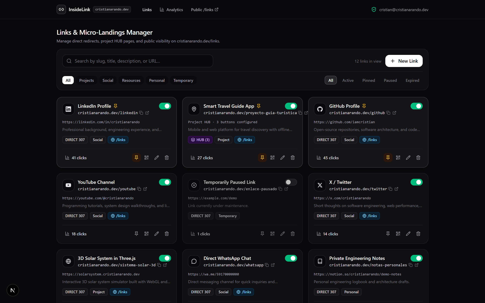
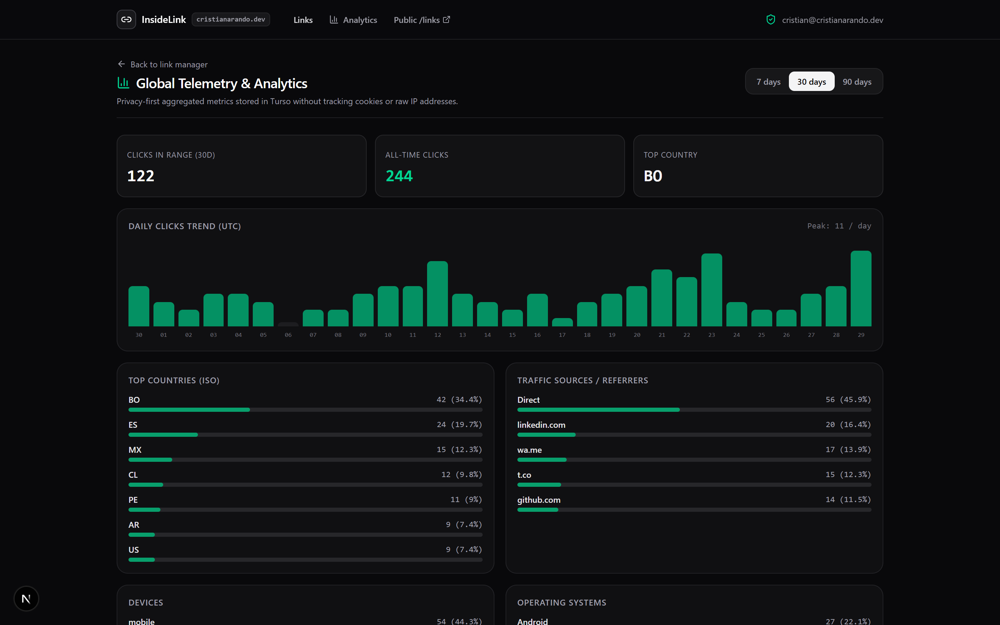
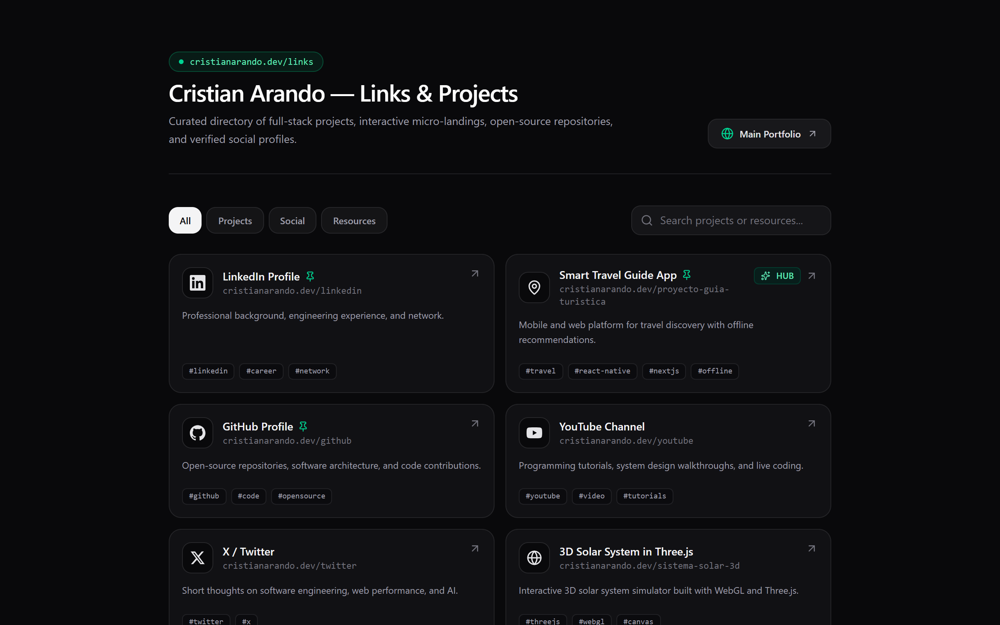
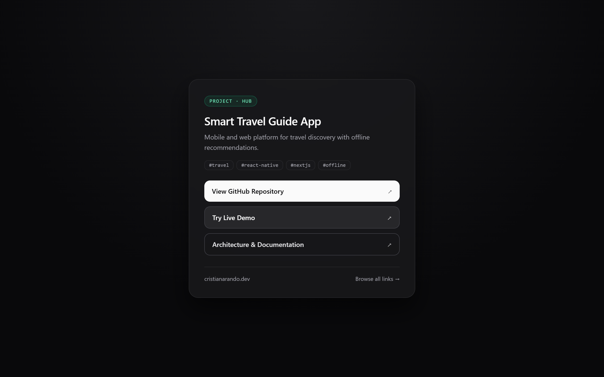
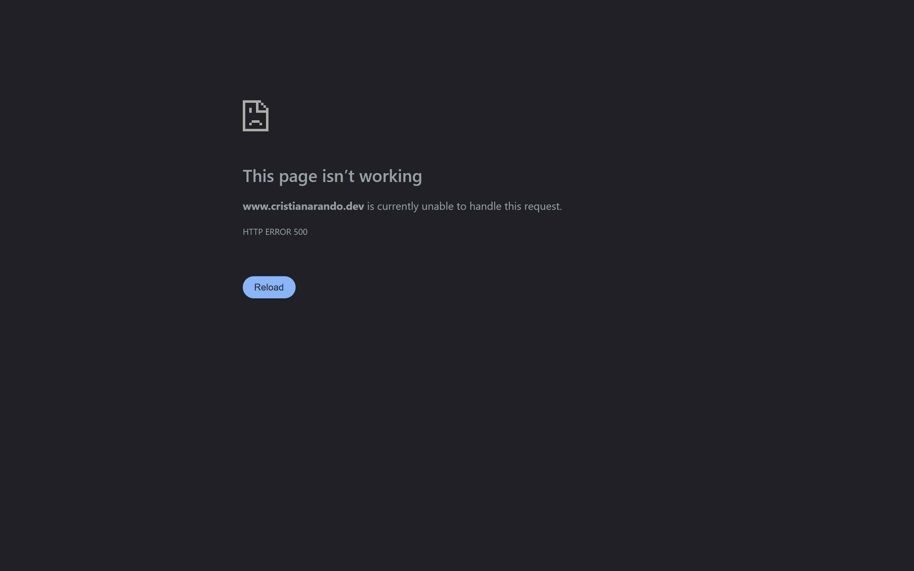
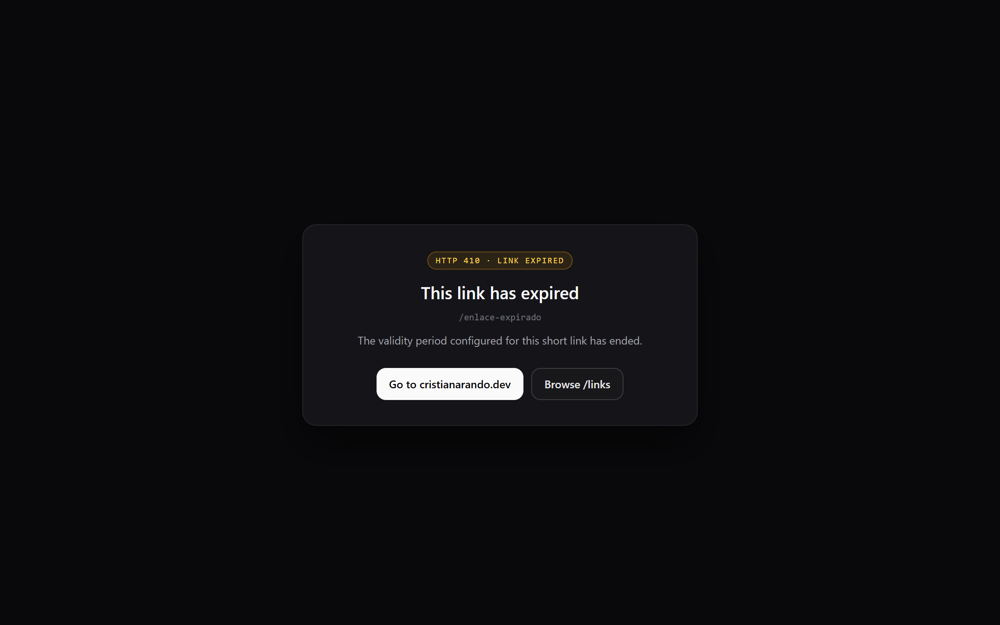
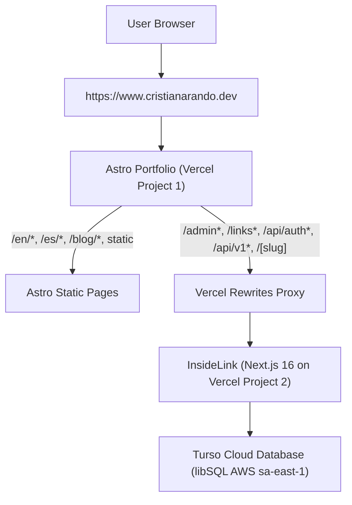

# InsideLink — Custom Link Shortener, Project Hubs & `/links` Directory

[](https://nextjs.org/)
[](https://react.dev/)
[](https://turso.tech/)
[](https://orm.drizzle.team/)
[](https://tailwindcss.com/)
[](https://www.better-auth.com/)
[](https://vitest.dev/)
[](https://www.cristianarando.dev/links/)

**InsideLink** is a self-hosted, single-owner link shortening platform, project micro-landing hub (`type = 'HUB'`), vector QR code generator, and public directory (`/links`) engineered to co-exist natively under the primary domain **`https://cristianarando.dev`**.

---

## 📸 Visual Showcase

### 1. Private Admin Console (`/admin`)
*Manage shortlinks with real-time slug collision checks, live search debouncing, custom icon selector, and instant QR generation.*



---

### 2. Global Analytics & Telemetry (`/admin/analytics`)
*Zero-raw-IP privacy-first telemetry with interactive daily click trends, geographic breakdown, device/OS distribution, and top referrers.*



---

### 3. Public Links Directory (`/links`)
*Curated showcase for portfolio visitors featuring category tabs (Projects, Social, Resources), real-time search, and keyset-based infinite scroll.*



---

### 4. Interactive Micro-Landing (`type = 'HUB'`)
*Multi-action intermediate showcase for complex projects (`cristianarando.dev/proyecto-guia-turistica`).*



---

### 5. Security & Expiration Controls
| PIN Protection Interstitial | Expired Link Notice (`HTTP 410 Gone`) |
| :---: | :---: |
|  |  |

---

## ⚡ Key Architectural Highlights

1. **Seamless Reverse-Proxy Coexistence (`cristianarando.dev`):**
   Runs independently on Vercel (`inside-link.vercel.app`) while being mapped transparently under `https://www.cristianarando.dev` via Vercel rewrites. Zero downtime, zero collisions with Astro static assets or i18n routing (`/en/`, `/es/`).
2. **Sub-50ms Redirect Engine (`GET /[slug]`):**
   Fast-path direct redirects (`HTTP 307/301`) with asynchronous background telemetry execution via Next.js `after()`.
3. **Compound Keyset Pagination:**
   Infinite scroll driven by `(is_pinned DESC, id DESC)` over monotonic **ULIDs**, ensuring zero duplicate items and constant-time database queries even at scale.
4. **Single-Owner GitHub OAuth Lockdown:**
   Strictly enforced via `databaseHooks.account.create.before` blocking any login attempt whose GitHub numerical account ID does not match `ALLOWED_GITHUB_ID`.
5. **Polymorphic Link Modes:**
   - `DIRECT`: High-speed URL redirection.
   - `HUB`: Self-hosted responsive micro-landing showcasing multiple project repositories, live demos, and documentation links.
6. **Built-in Security Controls:**
   - `scrypt` key derivation with cryptographic salt for PIN-protected links (`timingSafeEqual`).
   - Rate limiting on sensitive endpoints (max 5 failed unlock attempts per 60 seconds).
   - Dynamic Open Graph meta generation for social preview crawlers (`WhatsApp`, `LinkedInBot`, `Twitterbot`) without consuming click quotas.

---

## 🛠️ Technology Stack

| Layer | Technology |
| :--- | :--- |
| **Runtime & Package Manager** | Node.js `v24.11.1` LTS + `pnpm` |
| **Full-Stack Framework** | Next.js `16.4.3` (App Router, Turbopack, `after()` API) + React `19.3.0` |
| **Edge Database** | Turso (`@libsql/client` SQLite/libSQL) + Drizzle ORM |
| **Authentication** | Better-Auth (`GitHub OAuth` locked to `ALLOWED_GITHUB_ID`) |
| **Validation & Cryptography** | Zod + `ulidx` (Monotonic ULIDs) + `node:crypto` (`scrypt` + `timingSafeEqual`) |
| **Styling & Icons** | Tailwind CSS v4 + Lucide React + Custom SVG Brand Icons |
| **Testing Suite** | Vitest (78 Unit, Integration, and E2E tests) + Playwright |

---

## 🚀 Quickstart & Local Development

### Prerequisites
- Node.js $\ge$ `20.18.0` (Recommended: `24.x`)
- `pnpm` $\ge$ `9.x`

### 1. Clone & Install Dependencies
```bash
git clone git@github.com:iamcristian/inside-link.git
cd inside-link
pnpm install
```

### 2. Environment Configuration
Copy the template environment variables:
```bash
cp .env.example .env
```

Default local environment values:
```ini
TURSO_DATABASE_URL="file:local.db"
TURSO_AUTH_TOKEN=""
BETTER_AUTH_SECRET="local-development-secret-key-at-least-32-chars-long"
BETTER_AUTH_URL="http://localhost:3000"
NEXT_PUBLIC_APP_URL="http://localhost:3000"
NEXT_PUBLIC_CANONICAL_URL="http://localhost:3000"
ALLOWED_GITHUB_ID="12345678"
ALLOWED_GITHUB_EMAIL="owner@example.com"
```

### 3. Run SQLite Migrations & Seed Idempotent Data
```bash
# Apply Drizzle migrations to local.db
pnpm db:migrate

# Seed with 18 sample links (DIRECT, HUB, PIN, Expired) and 120 analytics click events
pnpm db:seed
```

### 4. Start Development Server
```bash
pnpm dev
```
Open [http://localhost:3000](http://localhost:3000) in your browser:
- **Local Showcase Index**: [http://localhost:3000](http://localhost:3000)
- **Admin Dashboard**: [http://localhost:3000/admin](http://localhost:3000/admin) *(Local dev bypass enabled)*
- **Global Analytics**: [http://localhost:3000/admin/analytics](http://localhost:3000/admin/analytics)
- **Public Directory**: [http://localhost:3000/links](http://localhost:3000/links)
- **HUB Demo**: [http://localhost:3000/proyecto-guia-turistica](http://localhost:3000/proyecto-guia-turistica)

---

## 🧪 Testing & Verification

The project includes 78 automated tests covering unit utilities, database invariants, route handlers, and end-to-end user journeys:

```bash
# Run strict TypeScript typechecking
pnpm typecheck

# Run full Vitest test suite (Unit + Integration + Flow)
pnpm test

# Production build verification
pnpm build
```

---

## 🌐 Production Deployment Architecture

InsideLink is deployed across two independent Vercel projects working seamlessly together:



### Required Vercel Environment Variables
Set these in your `inside-link` project on Vercel:

| Variable | Description | Example |
| :--- | :--- | :--- |
| `TURSO_DATABASE_URL` | Cloud Turso libSQL connection URL | `libsql://your-db-name-org.turso.io` |
| `TURSO_AUTH_TOKEN` | Read/write Turso database token | `your_turso_auth_token` |
| `BETTER_AUTH_SECRET` | 32+ character random secret | `openssl rand -base64 32` |
| `BETTER_AUTH_URL` | Canonical Better-Auth root URL | `https://your-domain.dev` |
| `GITHUB_CLIENT_ID` | GitHub OAuth App Client ID | `your_github_oauth_client_id` |
| `GITHUB_CLIENT_SECRET` | GitHub OAuth App Secret | `your_github_oauth_client_secret` |
| `ALLOWED_GITHUB_ID` | Owner's immutable GitHub user ID | `12345678` |
| `ALLOWED_GITHUB_EMAIL` | Owner's verified email address | `owner@example.com` |
| `NEXT_PUBLIC_APP_URL` | Public-facing app URL | `https://www.your-domain.dev` |
| `NEXT_PUBLIC_CANONICAL_URL` | Canonical domain URL | `https://your-domain.dev` |

### Portfolio Reverse-Proxy Rules (`my-portfolio/vercel.json`)
The primary portfolio routes InsideLink endpoints cleanly using Vercel rewrites:

```json
{
  "rewrites": [
    { "source": "/_next/:path*", "destination": "https://inside-link.vercel.app/_next/:path*" },
    { "source": "/_next/:path*/", "destination": "https://inside-link.vercel.app/_next/:path*" },
    { "source": "/admin", "destination": "https://inside-link.vercel.app/admin" },
    { "source": "/admin/", "destination": "https://inside-link.vercel.app/admin" },
    { "source": "/admin/:path*", "destination": "https://inside-link.vercel.app/admin/:path*" },
    { "source": "/admin/:path*/", "destination": "https://inside-link.vercel.app/admin/:path*" },
    { "source": "/login", "destination": "https://inside-link.vercel.app/login" },
    { "source": "/login/", "destination": "https://inside-link.vercel.app/login" },
    { "source": "/links", "destination": "https://inside-link.vercel.app/links" },
    { "source": "/links/", "destination": "https://inside-link.vercel.app/links" },
    { "source": "/api/auth/:path*", "destination": "https://inside-link.vercel.app/api/auth/:path*" },
    { "source": "/api/auth/:path*/", "destination": "https://inside-link.vercel.app/api/auth/:path*" },
    { "source": "/api/v1/:path*", "destination": "https://inside-link.vercel.app/api/v1/:path*" },
    { "source": "/api/v1/:path*/", "destination": "https://inside-link.vercel.app/api/v1/:path*" },
    { "source": "/:slug((?!es$|en$|de$|ru$|ja$|projects$|uses$|cv$|blog$|bookshelf$|library$|search$|series$|search-index$|news-sitemap$|rss$|about$|contact$|_astro$|_next$|assets$|images$|fonts$|icons$|brand$)[a-z0-9][a-z0-9-_]{2,99})", "destination": "https://inside-link.vercel.app/:slug" },
    { "source": "/:slug((?!es$|en$|de$|ru$|ja$|projects$|uses$|cv$|blog$|bookshelf$|library$|search$|series$|search-index$|news-sitemap$|rss$|about$|contact$|_astro$|_next$|assets$|images$|fonts$|icons$|brand$)[a-z0-9][a-z0-9-_]{2,99})/", "destination": "https://inside-link.vercel.app/:slug" }
  ]
}
```

---

## 📚 Technical Documentation Index

Detailed engineering specifications are available in the [`docs/`](docs/) directory:

- [docs/README.md](docs/README.md) — Architectural suite overview and guidelines.
- [docs/01-requerimientos-y-producto.md](docs/01-requerimientos-y-producto.md) — 24 Functional and 12 Non-Functional Requirements.
- [docs/02-arquitectura-del-sistema.md](docs/02-arquitectura-del-sistema.md) — C4 Architecture models and zero-collision strategy.
- [docs/03-modelo-de-datos-e-invariantes.md](docs/03-modelo-de-datos-e-invariantes.md) — Turso/SQLite database schema, indices, and compound cursor pagination.
- [docs/04-api-flujos-y-motor-redireccion.md](docs/04-api-flujos-y-motor-redireccion.md) — Slug normalization pipeline and REST contracts.
- [docs/05-seguridad-operaciones-y-testing.md](docs/05-seguridad-operaciones-y-testing.md) — Single-owner security model, `scrypt` hashing, and privacy-first telemetry.
- [docs/06-backlog-de-tareas.md](docs/06-backlog-de-tareas.md) — Full standardized 24-task engineering backlog (`T-001` to `T-024`).
- [docs/implementation-status.md](docs/implementation-status.md) — Implementation status log (`24/24 COMPLETE`).

---

## 📄 License

Proprietary software — Designed & Developed by [Cristian Arando](https://cristianarando.dev). All rights reserved.
