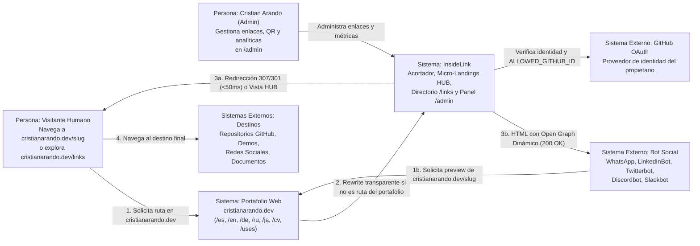
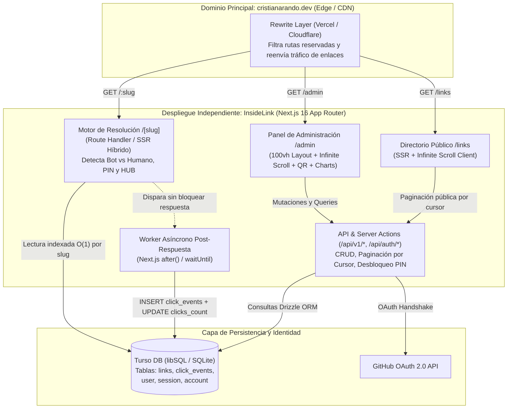
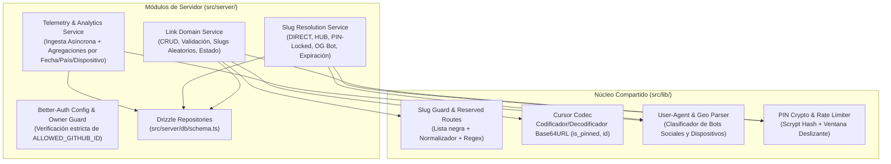

# InsideLink (`cristianarando.dev`) — Arquitectura del Sistema y Coexistencia

> **Estado:** Línea base de arquitectura aprobada.  
> **Lectura complementaria:** [`01-requerimientos-y-producto.md`](01-requerimientos-y-producto.md), [`03-modelo-de-datos-e-invariantes.md`](03-modelo-de-datos-e-invariantes.md) y [`04-api-flujos-y-motor-redireccion.md`](04-api-flujos-y-motor-redireccion.md).

---

## 1. Decisión Arquitectónica y Topología

**InsideLink** se construye como una aplicación **Full-Stack monolítica modular en Next.js (App Router)** respaldada por **Turso (libSQL / SQLite distribuido en el Edge)** y **Drizzle ORM**, desplegada de forma totalmente independiente del repositorio del portafolio principal y conectada al dominio **`cristianarando.dev`** mediante reglas de **Rewrite / Reverse Proxy** (Opción A).

### ¿Por qué esta topología?
1. **Desacoplamiento total del Portafolio:** El portafolio de `cristianarando.dev` mantiene su propio ciclo de vida, compilación estática/SSR e internacionalización (`/es`, `/en`, `/de`, `/ru`, `/ja`) sin ensuciar sus dependencias con lógica de base de datos, sesiones OAuth o analíticas de enlaces.
2. **Latencia mínima ($\mathcal{O}(1)$ en lectura de índice):** Turso (libSQL sobre HTTP/WebSockets) permite lecturas indexadas por `slug` en milisegundos desde funciones Serverless/Edge sin necesidad de mantener pools de conexiones TCP pesados.
3. **Telemetría fuera del camino crítico:** Next.js `after()` permite devolver el código `307/301` inmediatamente al navegador mientras la escritura del evento analítico se completa en segundo plano.

---

## 2. Matriz de Stack Tecnológico Fijado

La tarea **T-001** fijará las versiones exactas compatibles en `package.json` y `pnpm-lock.yaml`. Ningún paquete debe instalarse con rangos abiertos ni `latest` implícito.

| Capa / Responsabilidad | Tecnología Seleccionada | Justificación y Límite de Implementación |
| :--- | :--- | :--- |
| **Runtime & Gestor** | Node.js 24 LTS + `pnpm` | Un único `pnpm-lock.yaml`, scripts reproducibles y soporte nativo de TypeScript estricto. |
| **Framework Full-Stack** | Next.js 16 (App Router) + React 19 | Route Handlers para `/[slug]` y API, Server Components para `/links` y `/admin`, y `after()` para telemetría asíncrona. |
| **Base de Datos** | Turso (`@libsql/client`) — SQLite / libSQL | En desarrollo/test usa archivo o servidor libSQL local (`file:local.db`); en producción conecta a réplica Turso vía HTTPS. |
| **ORM & Migraciones** | Drizzle ORM (`drizzle-orm/sqlite-core`) + `drizzle-kit` | Cero sobrecarga de binario Rust en arranque en frío, SQL transparente y migraciones versionadas en `src/server/db/migrations`. |
| **Autenticación** | Better-Auth (`better-auth` + adaptador Drizzle) | Proveedor GitHub OAuth con bloqueo estricto en servidor por `ALLOWED_GITHUB_ID` y sesiones en base de datos con cookies `HttpOnly`. |
| **Validación & Contratos** | Zod | Esquemas compartidos entre formularios cliente y endpoints/acciones del servidor (`src/lib/validations/*`). |
| **Identificadores** | `ulidx` (ULID) | Identificadores de 26 caracteres ordenables por tiempo que simplifican la paginación por cursor sin colisiones de milisegundo. |
| **UI, Estilos & Gráficas** | Tailwind CSS v4 + `shadcn/ui` + Lucide Icons + Recharts | Interfaz oscura/clara de alta precisión, modales accesibles (Radix), gráficas ligeras y skeletons fluidos. |
| **Códigos QR** | `qrcode` / `qrcode.react` (Canvas/SVG) | Generación determinista en cliente/servidor con soporte para nivel de corrección `H` y logo central embebido. |
| **Testing** | Vitest + Testing Library + Playwright | Pruebas unitarias de dominio, pruebas de integración reales contra SQLite/libSQL en memoria/archivo, y pruebas E2E de flujos críticos. |

---

## 3. Arquitectura de Coexistencia (`cristianarando.dev` $\leftrightarrow$ `inside-link`)

### 3.1. Flujo de Enrutamiento por Rewrites y Prevención de Colisión de Assets

Cuando un proyecto externo se monta mediante Rewrites debajo de un dominio principal (`cristianarando.dev`), existen dos riesgos clásicos en producción que esta arquitectura resuelve de raíz:

1. **Colisión de `/_next/static/*`:** Si el portafolio en `cristianarando.dev` usa Next.js (o migra a él) y `inside-link` también sirve sus assets desde `/_next/static/*`, el navegador pedirá los JS/CSS de `inside-link` al servidor del portafolio, recibiendo `404 Not Found`.
   * **Solución Obligatoria:** Configurar en `next.config.ts` de `inside-link` la propiedad `assetPrefix: process.env.NEXT_PUBLIC_ASSET_PREFIX` (apuntando a la URL de despliegue de `inside-link`, p. ej. `https://inside-link.vercel.app`, con encabezados CORS permitidos para `https://cristianarando.dev`). Así, el HTML de `/links`, `/admin` o `/[slug]` cargará sus bundles estáticos sin chocar jamás con `/_astro/*` ni `/_next/*` del portafolio.
2. **Preservación del Dominio Canónico y Geolocalización:**
   * `inside-link` define `NEXT_PUBLIC_CANONICAL_URL="https://cristianarando.dev"`. Todos los enlaces copiados al portapapeles, códigos QR y etiquetas `og:url` usan siempre `https://cristianarando.dev/[slug]`.
   * Si alguien accede directamente al dominio técnico `inside-link.vercel.app`, el middleware inyecta `X-Robots-Tag: noindex, nofollow` para evitar contenido duplicado en buscadores.

### 3.2. Regla Estándar de Rewrites para el Portafolio (`vercel.json`)

En el repositorio del portafolio principal (`cristianarando.dev`), la configuración de `rewrites` excluye explícitamente todas las rutas reservadas del portafolio y delega el resto a `inside-link`:

```json
{
  "$schema": "https://openapi.vercel.sh/vercel.json",
  "rewrites": [
    {
      "source": "/links",
      "destination": "https://inside-link.vercel.app/links"
    },
    {
      "source": "/admin/:path*",
      "destination": "https://inside-link.vercel.app/admin/:path*"
    },
    {
      "source": "/api/v1/:path*",
      "destination": "https://inside-link.vercel.app/api/v1/:path*"
    },
    {
      "source": "/api/auth/:path*",
      "destination": "https://inside-link.vercel.app/api/auth/:path*"
    },
    {
      "source": "/:slug((?!es$|es/|en$|en/|de$|de/|ru$|ru/|ja$|ja/|uses$|uses/|cv$|cv/|resume$|projects$|blog$|about$|contact$|work$|_next/|_astro/|assets/|public/|favicon\\.ico$|robots\\.txt$|sitemap\\.xml$|manifest\\.json$)[a-zA-Z0-9-_]+)",
      "destination": "https://inside-link.vercel.app/:slug"
    }
  ]
}
```

> [!IMPORTANT]
> **Doble Barrera Anti-Colisión:** Además del regex negativo en el `vercel.json` del portafolio, `inside-link` valida la misma lista negra en su propio backend (ver [`04-api-flujos-y-motor-redireccion.md`](04-api-flujos-y-motor-redireccion.md)) para que jamás pueda crearse en la base de datos un slug que compita con una ruta presente o futura del portafolio.

---

## 4. Diagramas de Arquitectura (Modelo C4)

### 4.1. Nivel 1 — Diagrama de Contexto del Sistema



### 4.2. Nivel 2 — Diagrama de Contenedores



### 4.3. Nivel 3 — Componentes Internos de `InsideLink`



---

## 5. Estructura Estandarizada del Repositorio (`inside-link`)

Todas las tareas de implementación en [`06-backlog-de-tareas.md`](06-backlog-de-tareas.md) utilizan exactamente estas rutas relativas dentro del workspace:

```text
inside-link/
├── docs/                                   # Documentación de arquitectura y seguimiento
│   ├── README.md
│   ├── 01-requerimientos-y-producto.md
│   ├── 02-arquitectura-del-sistema.md
│   ├── 03-modelo-de-datos-e-invariantes.md
│   ├── 04-api-flujos-y-motor-redireccion.md
│   ├── 05-seguridad-operaciones-y-testing.md
│   ├── 06-backlog-de-tareas.md
│   └── implementation-status.md
├── public/
│   └── brand/                              # Logo/isotipo para códigos QR y OG default
├── src/
│   ├── app/
│   │   ├── (public)/
│   │   │   ├── links/
│   │   │   │   └── page.tsx                # Directorio público tipo Linktree (/links)
│   │   │   └── [slug]/
│   │   │       ├── route.ts                # Motor principal de resolución GET /[slug]
│   │   │       └── hub/                    # Componentes de renderizado para HUB y PIN
│   │   ├── (admin)/
│   │   │   ├── admin/
│   │   │   │   ├── layout.tsx              # Guard de sesión + Shell 100vh
│   │   │   │   ├── page.tsx                # Dashboard con Infinite Scroll, búsqueda y filtros
│   │   │   │   └── analytics/
│   │   │   │       └── page.tsx            # Analíticas globales y detalle por enlace
│   │   │   └── login/
│   │   │       └── page.tsx                # Pantalla minimalista de acceso con GitHub
│   │   ├── api/
│   │   │   ├── auth/[...all]/route.ts      # Handler de Better-Auth
│   │   │   └── v1/
│   │   │       ├── links/
│   │   │       │   ├── route.ts            # GET paginado por cursor (admin) / POST crear
│   │   │       │   ├── check-slug/route.ts # GET disponibilidad y validación de slug
│   │   │       │   ├── public/route.ts     # GET paginado por cursor (solo is_public=true)
│   │   │       │   └── [id]/
│   │   │       │       ├── route.ts        # PATCH editar / DELETE eliminar
│   │   │       │       └── analytics/route.ts # GET métricas detalladas de un enlace
│   │   │       └── slug/[slug]/
│   │   │           └── unlock/route.ts     # POST validación de PIN y desbloqueo
│   │   ├── not-found.tsx                   # Página 404 temática con retorno al portafolio
│   │   ├── layout.tsx
│   │   └── globals.css
│   ├── components/
│   │   ├── admin/                          # LinkCard, LinkFormModal, QrModal, InfiniteLinkGrid
│   │   ├── hub/                            # HubLandingView, PinUnlockForm
│   │   ├── public-links/                   # PublicLinkDirectory, CategoryTabs
│   │   └── ui/                             # Primitivas shadcn/ui (Button, Dialog, Skeleton, etc.)
│   ├── hooks/
│   │   ├── use-infinite-scroll.ts          # Hook reusable con IntersectionObserver
│   │   └── use-debounced-value.ts          # Hook para búsqueda con debounce (300ms)
│   ├── lib/
│   │   ├── constants/
│   │   │   └── reserved-slugs.ts           # Lista negra canónica de rutas y extensiones
│   │   ├── validations/
│   │   │   ├── slug.schema.ts              # Normalizador y validador Zod de slugs
│   │   │   └── link.schema.ts              # Esquemas Zod de creación/edición (DIRECT y HUB)
│   │   ├── cursor.ts                       # Codificador/decodificador de cursor compuesto
│   │   ├── bot-detector.ts                 # Clasificación de User-Agent (Bot social vs Humano)
│   │   ├── geo-headers.ts                  # Extracción de país/ciudad/referrer desde headers
│   │   ├── qr-generator.ts                 # Utilidades de exportación SVG/PNG con logo
│   │   └── utils.ts
│   └── server/
│       ├── auth/
│       │   ├── config.ts                   # Configuración Better-Auth + hook ALLOWED_GITHUB_ID
│       │   └── session.ts                  # Helper requireAdminSession()
│       ├── crypto/
│       │   ├── pin.ts                      # Hash y verificación scrypt para PIN de enlaces
│       │   └── rate-limit.ts               # Rate limiter por ventana para protección de PIN
│       ├── db/
│       │   ├── index.ts                    # Instancia de cliente libSQL + Drizzle
│       │   ├── schema.ts                   # Tablas: links, click_events, auth tables
│       │   ├── seed.ts                     # Datos semilla de desarrollo
│       │   └── migrations/                 # Migraciones SQL generadas por drizzle-kit
│       └── services/
│           ├── link.service.ts             # Lógica de negocio CRUD + cursor pagination
│           ├── resolution.service.ts       # Máquina de decisión de /[slug]
│           └── analytics.service.ts        # Registro asíncrono y consultas agregadas
├── tests/
│   ├── unit/                               # Tests de slugs, cursores, bots, PIN y esquemas
│   ├── integration/                        # Tests de servicios y repositorios sobre libSQL local
│   └── e2e/                                # Tests Playwright de redirección, /admin y /links
├── drizzle.config.ts
├── next.config.ts
├── package.json
├── tsconfig.json
└── vitest.config.ts
```
