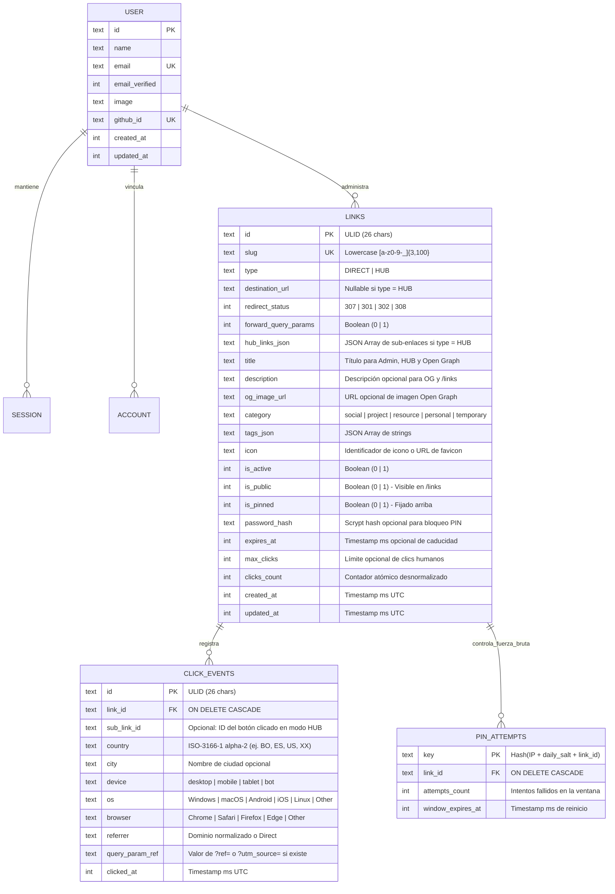

# InsideLink (`cristianarando.dev`) — Modelo de Datos e Invariantes en Turso (libSQL)

> **Estado:** Especificación normativa de persistencia.  
> **Motor de Base de Datos:** Turso (`@libsql/client`, motor compatible con SQLite 3.45+) + Drizzle ORM (`drizzle-orm/sqlite-core`).

---

## 1. Convenciones de Persistencia en SQLite / libSQL

A diferencia de PostgreSQL, SQLite utiliza afinidad de tipos dinámica (`TEXT`, `INTEGER`, `REAL`, `BLOB`). Para lograr integridad de nivel empresarial en Turso, aplicamos las siguientes convenciones obligatorias:

| Dimensión | Convención Estandarizada |
| :--- | :--- |
| **Claves Primarias (`id`)** | **ULID** en formato `TEXT` de 26 caracteres (`01J...`), generado en el servidor mediante `ulidx`. Es monótonamente creciente y ordenable lexicográficamente por fecha de creación sin requerir cursores de fecha compuestos. |
| **Nombres** | Columnas e índices en SQL en `snake_case`; propiedades de Drizzle en TypeScript en `camelCase`. |
| **Timestamps** | `integer('...', { mode: 'timestamp_ms' })` almacenando milisegundos UTC (Unix Epoch). Permite comparaciones numéricas ultrarrápidas (`expires_at <= :now_ms`). |
| **Booleanos** | `integer('...', { mode: 'boolean' })` (`0` o `1`) con `NOT NULL` y `CHECK (col IN (0, 1))`. |
| **JSON Estructurado** | `text('...', { mode: 'json' }).$type<T>()` validado con Zod antes de cada escritura y con `CHECK (json_valid(col))` en SQLite. |
| **Claves Foráneas** | Todas las conexiones inicializan o ejecutan con `PRAGMA foreign_keys = ON`. `click_events.link_id` define `ON DELETE CASCADE`. |
| **Slugs Canónicos** | Siempre almacenados en minúsculas. Restricción en tabla: `CHECK (slug = lower(slug) AND length(slug) BETWEEN 3 AND 100)`. |

---

## 2. Diagrama Entidad-Relación (ERD)



---

## 3. Diccionario Lógico de Tablas

### 3.1. Tabla Principal: `links`

| Columna | Tipo SQLite | Nulabilidad | Default | Descripción e Invariantes |
| :--- | :--- | :--- | :--- | :--- |
| `id` | `TEXT` | `NOT NULL PK` | — | ULID de 26 caracteres (`01J...`). |
| `slug` | `TEXT` | `NOT NULL UNIQUE` | — | Slug único en minúsculas. `CHECK (slug = lower(slug) AND length(slug) BETWEEN 3 AND 100)`. |
| `type` | `TEXT` | `NOT NULL` | `'DIRECT'` | `'DIRECT'` o `'HUB'`. `CHECK (type IN ('DIRECT', 'HUB'))`. |
| `destination_url` | `TEXT` | `NULL` | `NULL` | Obligatorio cuando `type = 'DIRECT'`. Debe iniciar con `http://` o `https://`. |
| `redirect_status` | `INTEGER` | `NOT NULL` | `307` | Código HTTP para enlaces `DIRECT`. `CHECK (redirect_status IN (301, 302, 307, 308))`. |
| `forward_query_params`| `INTEGER` | `NOT NULL` | `1` (`true`) | Si es `1`, propaga query strings entrantes (`?ref=cv`) al destino. |
| `hub_links_json` | `TEXT` | `NULL` | `NULL` | Obligatorio cuando `type = 'HUB'`. Array JSON validado de objetos `HubLinkItem`. |
| `title` | `TEXT` | `NOT NULL` | — | Título descriptivo (1 a 150 caracteres). Usado en `/admin`, `/links`, `HUB` y `og:title`. |
| `description` | `TEXT` | `NULL` | `NULL` | Resumen opcional (máx. 500 caracteres) para `og:description`, `HUB` y `/links`. |
| `og_image_url` | `TEXT` | `NULL` | `NULL` | URL HTTPS opcional para `og:image` personalizado al compartir en redes. |
| `category` | `TEXT` | `NOT NULL` | `'project'` | `CHECK (category IN ('social', 'project', 'resource', 'personal', 'temporary'))`. |
| `tags_json` | `TEXT` | `NOT NULL` | `'[]'` | Array JSON de etiquetas en minúsculas (máx. 10 tags por enlace). |
| `icon` | `TEXT` | `NOT NULL` | `'link'` | Nombre de icono (ej. `github`, `globe`, `linkedin`, `book-open`) o `'auto-favicon'`. |
| `is_active` | `INTEGER` | `NOT NULL` | `1` (`true`) | Interruptor manual para pausar o reactivar el enlace sin borrarlo. |
| `is_public` | `INTEGER` | `NOT NULL` | `0` (`false`) | Por seguridad es privado por defecto. Solo si es `1` aparece en `/links`. |
| `is_pinned` | `INTEGER` | `NOT NULL` | `0` (`false`) | Si es `1`, aparece fijado al principio en `/admin` y en `/links`. |
| `password_hash` | `TEXT` | `NULL` | `NULL` | Hash `scrypt` (`salt:hash`) si el enlace está protegido con PIN/contraseña. |
| `expires_at` | `INTEGER` | `NULL` | `NULL` | Timestamp en ms UTC tras el cual el enlace se considera caducado. |
| `max_clicks` | `INTEGER` | `NULL` | `NULL` | Entero positivo (`CHECK (max_clicks IS NULL OR max_clicks > 0)`). |
| `clicks_count` | `INTEGER` | `NOT NULL` | `0` | Contador desnormalizado de clics humanos (`CHECK (clicks_count >= 0)`). |
| `created_at` | `INTEGER` | `NOT NULL` | `unixepoch()*1000`| Timestamp de creación en ms UTC. |
| `updated_at` | `INTEGER` | `NOT NULL` | `unixepoch()*1000`| Timestamp de última modificación en ms UTC. |

#### Estructura Tipada de `hub_links_json` (`HubLinkItem[]`)
Cuando `type = 'HUB'`, `hub_links_json` almacena un arreglo de entre `1` y `12` elementos con el siguiente contrato Zod:
```typescript
export interface HubLinkItem {
  id: string;          // Identificador corto (ej. "repo", "demo", "docs")
  label: string;       // Texto del botón (ej. "Ver Repositorio en GitHub")
  url: string;         // URL absoluta http:// o https://
  icon: string;        // Icono Lucide/SimpleIcons (ej. "github", "external-link", "play")
  variant: "primary" | "secondary" | "outline";
}
```

### 3.2. Tabla de Analíticas: `click_events`

| Columna | Tipo SQLite | Nulabilidad | Descripción |
| :--- | :--- | :--- | :--- |
| `id` | `TEXT` | `NOT NULL PK` | ULID del evento de clic. |
| `link_id` | `TEXT` | `NOT NULL FK` | Referencia a `links.id` (`ON DELETE CASCADE`). |
| `sub_link_id` | `TEXT` | `NULL` | Si fue un clic dentro de una micro-landing `HUB`, indica qué botón se pulsó. |
| `country` | `TEXT` | `NOT NULL` | Código de país ISO de 2 letras (`'BO'`, `'ES'`, `'US'`) o `'XX'` si es desconocido. |
| `city` | `TEXT` | `NULL` | Ciudad decodificada de headers (`x-vercel-ip-city`) si está disponible. |
| `device` | `TEXT` | `NOT NULL` | `'desktop'`, `'mobile'`, `'tablet'` o `'bot'`. |
| `os` | `TEXT` | `NOT NULL` | `'Windows'`, `'macOS'`, `'Android'`, `'iOS'`, `'Linux'`, `'Other'`. |
| `browser` | `TEXT` | `NOT NULL` | `'Chrome'`, `'Safari'`, `'Firefox'`, `'Edge'`, `'Other'`. |
| `referrer` | `TEXT` | `NOT NULL` | Hostname limpio del `Referer` (ej. `'linkedin.com'`, `'github.com'`) o `'Direct'`. |
| `query_param_ref`| `TEXT` | `NULL` | Valor capturado de `?ref=` o `?utm_source=` (máx. 64 chars sanitizados). |
| `clicked_at` | `INTEGER` | `NOT NULL` | Timestamp del evento en ms UTC. |

### 3.3. Tabla de Control Anti-Fuerza Bruta: `pin_attempts`

Permite aplicar *rate limiting* sin depender de Redis externo, aprovechando la baja latencia de Turso:
* `key` (`TEXT PK`): `SHA-256(ip + daily_secret + link_id)` truncado a 32 caracteres hexadecimales (nunca guarda la IP real).
* `link_id` (`TEXT FK`): `ON DELETE CASCADE`.
* `attempts_count` (`INTEGER NOT NULL DEFAULT 1`).
* `window_expires_at` (`INTEGER NOT NULL`).

### 3.4. Tablas de Autenticación (`better-auth`)

Gestionadas por el esquema oficial de `better-auth` para Drizzle SQLite (`user`, `session`, `account`, `verification`), añadiendo un índice único o validación sobre la cuenta del proveedor `github` para garantizar que solo exista el usuario cuyo `accountId` coincida con `ALLOWED_GITHUB_ID`.

---

## 4. Índices e Invariantes Críticas

### 4.1. Índices Obligatorios en SQLite / Turso

1. **`idx_links_slug_unique` (UNIQUE):** `ON links(slug)` — Garantiza resolución en $\mathcal{O}(\log N)$ en el camino crítico de `/[slug]`.
2. **`idx_links_admin_cursor`:** `ON links(is_pinned DESC, id DESC)` — Soporta el Infinite Scroll del Dashboard `/admin` sin *full table scan* ni *filesort*.
3. **`idx_links_public_cursor`:** `ON links(is_public, is_active, is_pinned DESC, id DESC)` — Soporta el directorio público `/links` y el filtrado por categoría.
4. **`idx_links_category`:** `ON links(category, is_pinned DESC, id DESC)` — Acelera pestañas por categoría.
5. **`idx_click_events_link_time`:** `ON click_events(link_id, clicked_at DESC)` — Soporta gráficas de serie temporal de los últimos 7/30 días por enlace.
6. **`idx_click_events_global_time`:** `ON click_events(clicked_at DESC)` — Soporta analíticas globales del panel.

### 4.2. Invariante de Integridad Polimórfica (`DIRECT` vs `HUB`)

Validada tanto en `link.schema.ts` (Zod) como mediante `CHECK` en SQL:
```sql
CHECK (
  (type = 'DIRECT' AND destination_url IS NOT NULL AND length(trim(destination_url)) > 0)
  OR
  (type = 'HUB' AND hub_links_json IS NOT NULL AND json_valid(hub_links_json) = 1 AND json_array_length(hub_links_json) >= 1)
)
```

### 4.3. Algoritmo de Paginación por Cursor Compuesto `(is_pinned, id)`

Dado que tanto en `/admin` como en `/links` los enlaces fijados (`is_pinned = 1`) deben mostrarse primero y luego ordenarse del más reciente al más antiguo (`id DESC`, aprovechando que ULID codifica el timestamp en sus primeros 10 caracteres):

1. **Estructura del Cursor:**
   ```typescript
   export interface LinkCursor {
     p: 0 | 1;   // Valor de is_pinned del último elemento entregado
     id: string; // ULID del último elemento entregado
   }
   ```
   Se serializa como JSON y se codifica en `base64url` para viajar limpiamente como `?cursor=eyJwIjoxLCJpZCI6IjAxSi4uLiJ9`.

2. **Condición SQL de Continuación (Keyset Pagination):**
   Para obtener la página siguiente con tamaño `limit` (solicitando `limit + 1` filas para saber si existe `hasNextPage`):
   ```sql
   SELECT *
   FROM links
   WHERE
     (
       is_pinned < :cursor_p
       OR (is_pinned = :cursor_p AND id < :cursor_id)
     )
     -- Filtros opcionales de categoría, estado o búsqueda:
     AND (:category IS NULL OR category = :category)
   ORDER BY is_pinned DESC, id DESC
   LIMIT :limit_plus_one;
   ```
3. **Propiedades Garantizadas:**
   * **Complejidad constante:** No usa `OFFSET`, por lo que la página 1 y la página 50 responden igual de rápido.
   * **Sin duplicados ni saltos:** Si se crea un nuevo enlace mientras el usuario hace scroll, el cursor anclado en `(p, id)` no desplaza ni repite las tarjetas ya vistas.

### 4.4. Invariante de Actualización Atómica de Clics

Cuando ocurre un clic humano válido sobre un enlace:
```sql
UPDATE links
SET
  clicks_count = clicks_count + 1,
  updated_at = :now_ms
WHERE id = :link_id
  AND is_active = 1
  AND (expires_at IS NULL OR expires_at > :now_ms)
  AND (max_clicks IS NULL OR clicks_count < max_clicks);
```
Esto evita condiciones de carrera (*race conditions*) de tipo *read-modify-write* cuando múltiples visitantes hacen clic simultáneamente en un enlace recién compartido en redes sociales.
