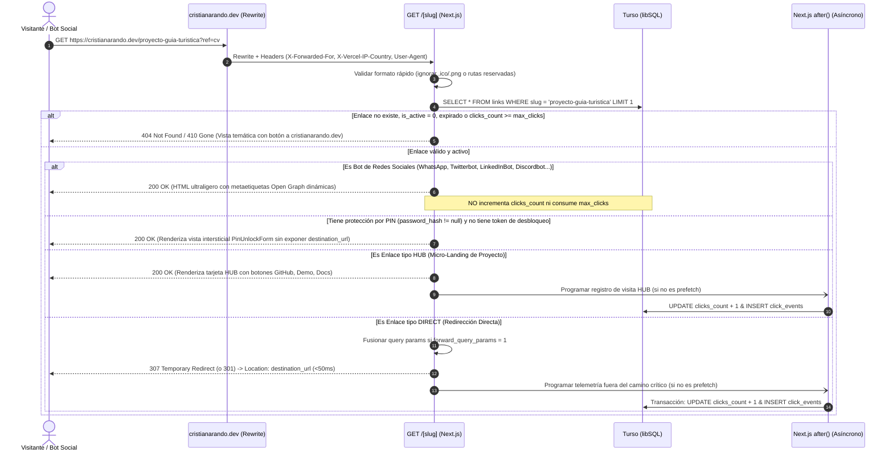
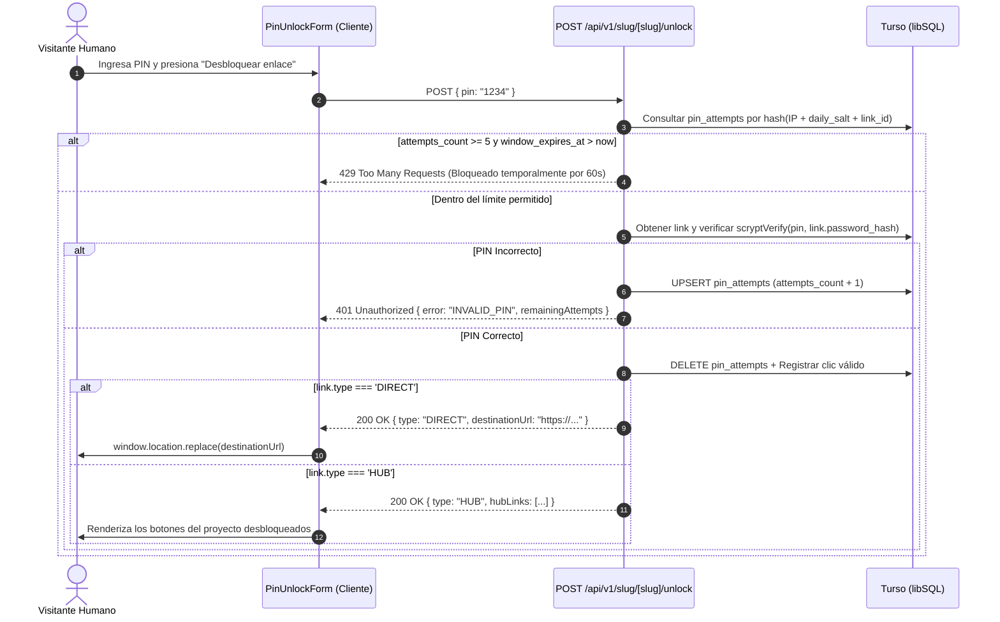
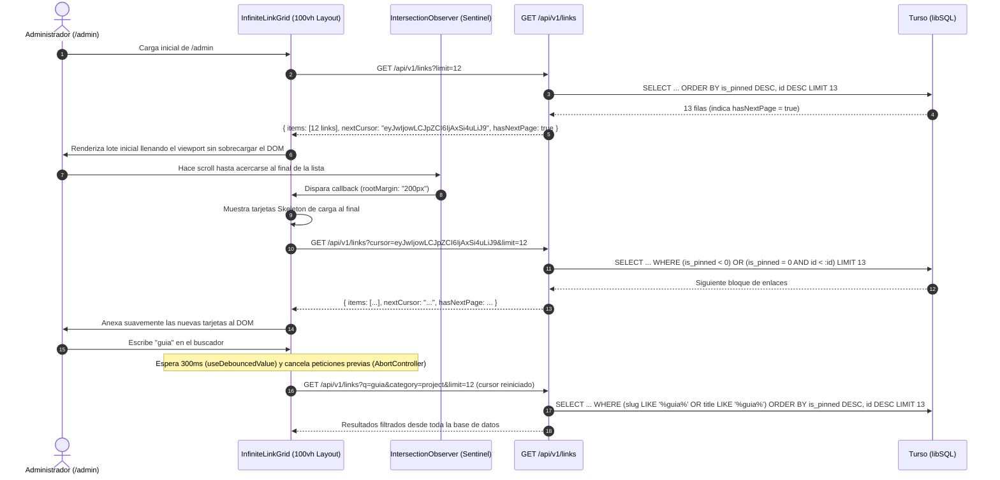

# InsideLink (`cristianarando.dev`) — Flujos de Dominio, Motor de Redirección y Contratos API

> **Estado:** Especificación normativa de comportamiento y contratos HTTP.  
> **Lectura complementaria:** [`01-requerimientos-y-producto.md`](01-requerimientos-y-producto.md) y [`03-modelo-de-datos-e-invariantes.md`](03-modelo-de-datos-e-invariantes.md).

---

## 1. Motor Anti-Colisión y Normalización de Slugs (`src/lib/validations/slug.schema.ts`)

Para proteger todas las rutas actuales y futuras de `cristianarando.dev`, cualquier slug pasa por una tubería determinista de **Normalización $\rightarrow$ Validación Sintáctica $\rightarrow$ Verificación de Lista Negra**:

### 1.1. Tubería de Transformación (`normalizeSlug`)
1. `input.trim().toLowerCase()`
2. Reemplazar secuencias de espacios en blanco (`\s+`) por un único guion medio (`-`).
3. Colapsar guiones repetidos (`--+` $\rightarrow$ `-`).

### 1.2. Reglas de Validación Sintáctica
* **Longitud:** Mínimo `3` caracteres, máximo `100` caracteres.
  * *Justificación:* Bloquear cualquier slug de 1 o 2 caracteres protege automáticamente **todos** los códigos de idioma ISO 639-1 de 2 letras (`es`, `en`, `de`, `ru`, `ja`, `fr`, `pt`, `it`, `zh`, `ko`, etc.) si el portafolio añade más idiomas en el futuro.
* **Expresión Regular Canónica:** `^[a-z0-9]+(?:[-_][a-z0-9]+)*$`
  * Impide puntos (`.`), barras (`/`), caracteres especiales y guiones al inicio o al final.
* **Bloqueo de Extensiones de Archivo:** Cualquier ruta que contenga un punto o termine en extensiones técnicas (`.ico`, `.xml`, `.txt`, `.json`, `.webmanifest`, `.png`, `.jpg`, `.svg`, `.webp`, `.js`, `.css`, `.map`, `.woff2`) es rechazada en el acto sin consultar la base de datos.

### 1.3. Lista Negra Canónica (`RESERVED_SLUGS`)

```typescript
export const RESERVED_SLUGS = new Set([
  // 1. Rutas de idiomas del portafolio (i18n)
  "es", "en", "de", "ru", "ja", "fr", "pt", "it", "zh", "ko",
  // 2. Rutas estáticas y secciones del portafolio
  "uses", "cv", "resume", "projects", "proyectos", "blog", "posts",
  "about", "sobre-mi", "contact", "contacto", "work", "experience",
  "portfolio", "now", "colophon", "testimonials", "services",
  // 3. Rutas del propio sistema InsideLink
  "admin", "dashboard", "login", "logout", "signin", "signout",
  "api", "auth", "links", "hub", "unlock", "qr", "analytics", "settings",
  // 4. Rutas técnicas, frameworks y archivos raíz
  "_next", "_astro", "_il", "_vercel", "assets", "public", "static",
  "images", "fonts", "brand", "favicon", "robots", "sitemap", "manifest",
  "404", "500", "error", "health", "ping"
]);
```

---

## 2. Máquina de Decisión y Flujos de `/[slug]`

### 2.1. Diagrama de Secuencia: Resolución de `/[slug]` (Humano vs. Bot vs. PIN vs. HUB)



### 2.2. Reglas de Detección de Bots Sociales y Prefetch (`src/lib/bot-detector.ts`)

1. **Lista de User-Agents de Bots Sociales (`isSocialPreviewBot`):**
   * `WhatsApp`, `facebookexternalhit`, `Facebot`, `Twitterbot`, `LinkedInBot`, `Discordbot`, `Slackbot`, `TelegramBot`, `Pinterest`, `SkypeUriPreview`, `vkShare`, `redditbot`.
   * Cuando `isSocialPreviewBot(userAgent) === true`:
     * El servidor devuelve un documento HTML mínimo (`<head>` con `og:title`, `og:description`, `og:image`, `og:url`, `twitter:card="summary_large_image"`).
     * Si el enlace está protegido por PIN (`password_hash !== null`), el `og:description` muestra `"Enlace protegido con PIN en cristianarando.dev"` y nunca expone información sensible ni el destino.
2. **Detección de Prefetch de Navegador (`isPrefetchRequest`):**
   * Inspecciona headers: `Purpose: prefetch`, `Sec-Purpose: prefetch`, `X-Purpose: preview`, `Next-Router-Prefetch: 1`, `X-Moz: prefetch`.
   * Si es un prefetch, el servidor no ejecuta el bloque `after()` de telemetría para evitar inflar artificialmente `clicks_count` o agotar `max_clicks`.

### 2.3. Diagrama de Secuencia: Desbloqueo de Enlace con PIN (`POST /api/v1/slug/[slug]/unlock`)



---

## 3. Flujo de Viewport-Aware Loading (`100vh`) + Infinite Scroll + Búsqueda con Debounce



---

## 4. Contratos de API (`/api/v1/*`)

Todas las respuestas de API siguen una envolvente JSON consistente y códigos de error estructurados:

```typescript
// Respuesta exitosa paginada por cursor
export interface PaginatedResponse<T> {
  items: T[];
  nextCursor: string | null;
  hasNextPage: boolean;
}

// Respuesta de error estándar
export interface ApiErrorResponse {
  error: {
    code:
      | "UNAUTHORIZED"
      | "FORBIDDEN"
      | "NOT_FOUND"
      | "SLUG_RESERVED"
      | "SLUG_ALREADY_EXISTS"
      | "VALIDATION_ERROR"
      | "INVALID_PIN"
      | "RATE_LIMITED"
      | "LINK_EXPIRED"
      | "INTERNAL_ERROR";
    message: string;
    details?: Record<string, string[]>;
  };
}
```

### 4.1. Resumen de Endpoints

| Método y Ruta | Acceso | Propósito | Parámetros / Payload Clave |
| :--- | :--- | :--- | :--- |
| `GET /api/v1/links` | Admin (`Session`) | Listar enlaces en `/admin` con paginación por cursor, búsqueda y filtros. | Query: `cursor?`, `limit=12` (máx. 50), `q?`, `category?`, `status?` (`all`\|`active`\|`inactive`\|`expired`\|`pinned`). |
| `POST /api/v1/links` | Admin (`Session`) | Crear un nuevo enlace (`DIRECT` o `HUB`). | Body validado por `CreateLinkSchema` (incluye `slug` opcional para autogenerar, `type`, `destinationUrl`, `hubLinks`, `pin`, etc.). |
| `GET /api/v1/links/check-slug` | Admin (`Session`) | Validar en tiempo real si un slug es sintácticamente válido, no está reservado y está libre en BD. | Query: `slug` (y opcionalmente `excludeId` al editar). Devuelve `{ available: boolean, normalizedSlug: string, reason?: string }`. |
| `PATCH /api/v1/links/[id]` | Admin (`Session`) | Actualizar cualquier campo de un enlace o alternar rápidamente `isActive`, `isPinned`, `isPublic`. | Body parcial validado por `UpdateLinkSchema`. |
| `DELETE /api/v1/links/[id]` | Admin (`Session`) | Eliminar un enlace y sus `click_events` en cascada. | — |
| `GET /api/v1/links/[id]/analytics`| Admin (`Session`) | Obtener serie temporal (7d/30d), países, dispositivos, SO y referrers de un enlace o global (`id = 'overview'`). | Query: `range=7d\|30d\|90d`. |
| `GET /api/v1/links/public` | Público | Listar enlaces públicos activos (`is_public = 1 AND is_active = 1` y vigentes) para `/links`. | Query: `cursor?`, `limit=12`, `category?`, `q?`. |
| `POST /api/v1/slug/[slug]/unlock` | Público (Rate-limited)| Verificar PIN de un enlace protegido y devolver destino o sub-enlaces `HUB`. | Body: `{ pin: string }`. |
| `POST /api/v1/slug/[slug]/hub-click`| Público | Registrar clic asíncrono en un botón específico dentro de una micro-landing `HUB`. | Body: `{ subLinkId: string }`. |
