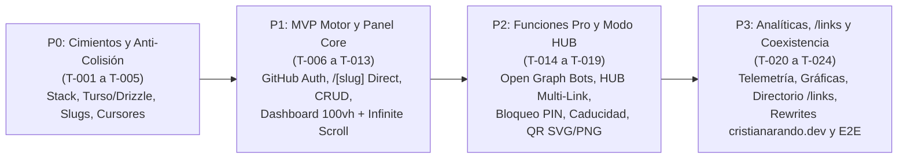

# InsideLink (`cristianarando.dev`) — Backlog Estandarizado de Tareas y Guía de Ejecución

> **Estado:** Plan de ejecución estandarizado. **Ninguna tarea de aplicación ha sido implementada aún.**  
> **Regla de Oro:** Ejecutar las tareas estrictamente en orden de dependencia, una tarea acotada a la vez. No marcar ninguna tarea como `COMPLETE` en [`docs/implementation-status.md`](implementation-status.md) sin haber ejecutado y comprobado sus criterios de aceptación (`Accept`).

---

## 1. Cómo Ejecutar este Plan

1. Leer [`README.md`](README.md), [`01-requerimientos-y-producto.md`](01-requerimientos-y-producto.md) y la tarea seleccionada `T-xxx`.
2. Consultar únicamente las secciones relevantes de [`02-arquitectura-del-sistema.md`](02-arquitectura-del-sistema.md), [`03-modelo-de-datos-e-invariantes.md`](03-modelo-de-datos-e-invariantes.md), [`04-api-flujos-y-motor-redireccion.md`](04-api-flujos-y-motor-redireccion.md) y [`05-seguridad-operaciones-y-testing.md`](05-seguridad-operaciones-y-testing.md).
3. Cada tarea debe producir:
   * Código o artefacto de configuración en las rutas indicadas en **Salidas esperadas**.
   * Pruebas unitarias, de integración o E2E correspondientes.
   * Actualización de [`docs/implementation-status.md`](implementation-status.md) con estado (`NOT_STARTED` / `IN_PROGRESS` / `BLOCKED` / `COMPLETE`), archivos creados/modificados, comandos ejecutados, resultados obtenidos y siguiente tarea habilitada.

### Escala de Complejidad
* **`[S]` (Small):** Módulo acotado, utilidad pura, configuración o vista aislada con pruebas unitarias.
* **`[M]` (Medium):** Característica que abarca múltiples capas (esquema + servicio + endpoint o componente interactivo) con pruebas de integración.
* **`[L]` (Large):** Flujo de dominio crítico o interfaz compuesta con múltiples estados que debe dividirse en subpasos verificables antes de codificar.

### Mapa de Dependencias entre Fases



---

## 2. Fase P0 — Cimientos, Esquema de Datos y Prevención de Colisiones

### T-001 — Inicializar proyecto Next.js, congelar versiones y configurar entorno estricto `[S]`
* **Depende de:** Ninguna.
* **Requerimientos:** `RNF-008`, `RNF-009`, `RNF-010`.
* **Salidas esperadas:**
  * `package.json`, `pnpm-lock.yaml`, `.nvmrc`, `tsconfig.json`, `next.config.ts`, `vitest.config.ts`, `.env.example`, `.gitignore`.
  * `src/lib/env.ts` (validador Zod de variables de entorno en servidor y cliente).
  * `docs/decisions/stack-versions.md` (registro de versiones exactas instaladas).
* **Pasos:**
  1. Inicializar Next.js 16 (App Router) con TypeScript estricto (`strict: true`, `noUncheckedIndexedAccess: true`), Tailwind CSS v4 y Vitest.
  2. Configurar `assetPrefix: process.env.NEXT_PUBLIC_ASSET_PREFIX || undefined` y cabeceras `X-Robots-Tag: noindex, nofollow` para dominios `.vercel.app` en `next.config.ts`.
  3. Implementar `src/lib/env.ts` validando `TURSO_DATABASE_URL`, `BETTER_AUTH_SECRET`, `GITHUB_CLIENT_ID`, `GITHUB_CLIENT_SECRET`, `ALLOWED_GITHUB_ID` y `NEXT_PUBLIC_CANONICAL_URL`.
* **Criterios de aceptación (`Accept`):**
  * `pnpm install`, `pnpm typecheck`, `pnpm build` y `pnpm test` finalizan con código `0` y un único `pnpm-lock.yaml`.
  * Si falta una variable obligatoria en `env.ts`, el validador arroja un error descriptivo inmediato.

---

### T-002 — Configurar cliente Turso (libSQL), esquema Drizzle ORM y migraciones base `[M]`
* **Depende de:** `T-001`.
* **Requerimientos:** `RNF-007`, `RNF-010`.
* **Salidas esperadas:**
  * `drizzle.config.ts`
  * `src/server/db/index.ts`
  * `src/server/db/schema.ts`
  * `src/server/db/migrations/*`
  * `tests/integration/db-schema.test.ts`
* **Pasos:**
  1. Configurar `@libsql/client` y `drizzle-orm/libsql` soportando tanto `file:local.db` (desarrollo), `file::memory:` (tests de integración) como URLs remotas de Turso.
  2. Definir en `src/server/db/schema.ts` las tablas `links`, `click_events`, `pin_attempts` y las tablas de autenticación (`user`, `session`, `account`, `verification`) siguiendo exactamente el diccionario e índices de [`03-modelo-de-datos-e-invariantes.md`](03-modelo-de-datos-e-invariantes.md).
  3. Generar la migración inicial con `drizzle-kit generate` e incluir las restricciones `CHECK` para `type IN ('DIRECT', 'HUB')`, `redirect_status IN (301, 302, 307, 308)`, `slug = lower(slug)` y `PRAGMA foreign_keys = ON`.
* **Criterios de aceptación (`Accept`):**
  * Las pruebas de integración aplican la migración sobre una base libSQL limpia y verifican que insertar un enlace `DIRECT` sin `destination_url`, un `slug` en mayúsculas o un `redirect_status = 999` falla a nivel de base de datos.
  * Eliminar un registro de `links` borra automáticamente sus filas asociadas en `click_events` y `pin_attempts` (`ON DELETE CASCADE`).

---

### T-003 — Implementar el Motor Anti-Colisión, Lista Negra de Rutas y Esquemas Zod de Slugs `[S]`
* **Depende de:** `T-001`.
* **Requerimientos:** `RF-001`, `RF-002`, `RNF-003`, `RNF-012`.
* **Salidas esperadas:**
  * `src/lib/constants/reserved-slugs.ts`
  * `src/lib/validations/slug.schema.ts`
  * `src/lib/validations/link.schema.ts`
  * `tests/unit/slug-validation.test.ts`
* **Pasos:**
  1. Codificar `RESERVED_SLUGS` incluyendo todos los idiomas (`es`, `en`, `de`, `ru`, `ja`, etc.), rutas del portafolio (`uses`, `cv`, `resume`, `projects`, `blog`, `about`, `contact`, `work`), rutas de InsideLink (`admin`, `dashboard`, `login`, `api`, `links`, `auth`) y rutas técnicas (`_next`, `_astro`, `favicon.ico`, `robots.txt`, `sitemap.xml`, `manifest.json`).
  2. Implementar `normalizeSlug(input)` (trim, lowercase, espacios a guiones, colapso de guiones repetidos) y `SlugSchema` exigiendo longitud `3..100`, regex `^[a-z0-9]+(?:[-_][a-z0-9]+)*$` y bloqueo de extensiones de archivo.
  3. Implementar `CreateLinkSchema` y `UpdateLinkSchema` validando URLs `http:`/`https:`, rechazando `javascript:`/`data:`, y exigiendo `destinationUrl` para `DIRECT` o `hubLinks` (1..12 ítems) para `HUB`.
* **Criterios de aceptación (`Accept`):**
  * Suite unitaria en `tests/unit/slug-validation.test.ts` con al menos 25 casos borde pasando: rutas de idiomas de 2 letras (`es`, `ja`, `fr`), archivos estáticos (`favicon.ico`, `app.js`), espacios (`"Mi Proyecto 2026"` $\rightarrow$ `"mi-proyecto-2026"`), esquemas XSS (`javascript:alert(1)`) y bucle autorreferencial.

---

### T-004 — Implementar el Codificador de Cursor Compuesto y Utilidades de Clasificación HTTP `[S]`
* **Depende de:** `T-001`.
* **Requerimientos:** `RF-007`, `RF-012`, `RF-022`, `RNF-012`.
* **Salidas esperadas:**
  * `src/lib/cursor.ts`
  * `src/lib/bot-detector.ts`
  * `src/lib/geo-headers.ts`
  * `tests/unit/cursor-and-detectors.test.ts`
* **Pasos:**
  1. Implementar `encodeLinkCursor({ p, id })` y `decodeLinkCursor(cursorStr)` en Base64URL con validación de formato ULID y bandera `p: 0 | 1`.
  2. Implementar `isSocialPreviewBot(userAgent)` (WhatsApp, Twitterbot, LinkedInBot, Discordbot, Slackbot, Facebook, TelegramBot) e `isPrefetchRequest(headers)`.
  3. Implementar `extractTrafficMetadata(headers, searchParams)` extrayendo `country` (`x-vercel-ip-country` / `cf-ipcountry`), `city`, `device`, `os`, `browser`, `referrer` normalizado y `?ref=` sin almacenar la IP.
* **Criterios de aceptación (`Accept`):**
  * Pruebas unitarias verifican round-trip exacto de cursores, rechazo de cursores corruptos sin lanzar excepciones no controladas, detección precisa de User-Agents reales de WhatsApp/LinkedIn/Discord/Chrome/iOS, e identificación de cabeceras `Purpose: prefetch`.

---

### T-005 — Crear Script de Semilla (Seed) y Datos de Prueba para Desarrollo Local `[S]`
* **Depende de:** `T-002`, `T-003`, `T-004`.
* **Requerimientos:** `RNF-007`, `RNF-012`.
* **Salidas esperadas:**
  * `src/server/db/seed.ts`
  * Script `pnpm db:seed` y `pnpm db:migrate` en `package.json`.
* **Pasos:**
  1. Construir un script idempotente que inserte 18 enlaces realistas (combinando redes sociales como `github`, `linkedin`, proyectos tipo `HUB` como `proyecto-guia-turistica`, enlaces fijados `is_pinned = 1`, enlaces privados, un enlace con PIN de prueba `1234` y un enlace expirado) junto con 120 eventos en `click_events` distribuidos en los últimos 30 días.
  2. Impedir que el seed se ejecute accidentalmente si `NODE_ENV === 'production'` sin bandera explícita.
* **Criterios de aceptación (`Accept`):**
  * `pnpm db:migrate && pnpm db:seed` pobla `local.db` limpiamente; ejecutarlo dos veces seguidas no duplica registros ni rompe restricciones `UNIQUE`.

---

## 3. Fase P1 — MVP: Autenticación, Motor de Redirección y Panel Core (`100vh` + Infinite Scroll)

### T-006 — Configurar Autenticación GitHub OAuth con Bloqueo de Propietario Único (`Better-Auth`) `[M]`
* **Depende de:** `T-002`.
* **Requerimientos:** `RF-010`, `RNF-004`.
* **Salidas esperadas:**
  * `src/server/auth/config.ts`
  * `src/server/auth/session.ts`
  * `src/app/api/auth/[...all]/route.ts`
  * `src/app/(admin)/login/page.tsx`
  * `tests/integration/auth-owner-guard.test.ts`
* **Pasos:**
  1. Configurar `better-auth` con adaptador Drizzle SQLite y proveedor GitHub OAuth.
  2. Implementar el hook de verificación de propietario que compara el ID numérico de la cuenta de GitHub con `env.ALLOWED_GITHUB_ID` (y opcionalmente `ALLOWED_GITHUB_EMAIL`), rechazando con `403 FORBIDDEN` cualquier otra cuenta antes de crear usuario o sesión.
  3. Crear el helper `requireAdminSession()` para proteger Route Handlers, Server Actions y el layout de `/admin`.
  4. Construir la pantalla `/login` con estética sobria y botón de inicio con GitHub.
* **Criterios de aceptación (`Accept`):**
  * Pruebas de integración verifican que un perfil OAuth cuyo `githubId !== ALLOWED_GITHUB_ID` es rechazado con `403` y deja `0` filas en las tablas `user` y `session`.
  * Solicitar `/admin` sin sesión redirige a `/login`.

---

### T-007 — Implementar el Servicio de Dominio de Enlaces (CRUD, Slugs Aleatorios y Paginación por Cursor) `[M]`
* **Depende de:** `T-002`, `T-003`, `T-004`.
* **Requerimientos:** `RF-001`, `RF-002`, `RF-003`, `RF-011`, `RF-012`, `RF-013`, `RF-014`.
* **Salidas esperadas:**
  * `src/server/services/link.service.ts`
  * `tests/integration/link-service.test.ts`
* **Pasos:**
  1. Implementar `createLink`, `updateLink`, `deleteLink`, `toggleLinkFlags` (`isActive`, `isPinned`, `isPublic`) y `checkSlugAvailability(slug, excludeId?)`.
  2. Implementar `generateUniqueRandomSlug(length = 6)` verificando que no caiga en `RESERVED_SLUGS` ni exista en `links`.
  3. Implementar `listLinksPaginated({ cursor, limit, query, category, status, publicOnly })` aplicando la consulta de *keyset pagination* sobre `(is_pinned DESC, id DESC)` con `limit + 1`.
* **Criterios de aceptación (`Accept`):**
  * Pruebas de integración con 30 enlaces (5 con `is_pinned = true` y 25 con `is_pinned = false`) recorren 3 páginas de 12 ítems usando `nextCursor`: no hay un solo enlace duplicado ni omitido en la transición de fijados a no fijados.
  * La búsqueda `query` filtra por `slug`, `title`, `description` y `destination_url` ignorando mayúsculas/minúsculas.

---

### T-008 — Implementar el Servicio de Resolución de `/[slug]` y Ruta de Redirección Directa `[M]`
* **Depende de:** `T-004`, `T-007`.
* **Requerimientos:** `RF-004`, `RF-005`, `RF-006`, `RF-021`, `RNF-001`, `RNF-003`.
* **Salidas esperadas:**
  * `src/server/services/resolution.service.ts`
  * `src/app/(public)/[slug]/route.ts`
  * `src/app/not-found.tsx`
  * `tests/integration/slug-resolution.test.ts`
* **Pasos:**
  1. Implementar la máquina de estados `resolveSlugRequest(slug, requestHeaders, searchParams)` que distingue:
     * Slug inválido/reservado/inexistente $\rightarrow$ `NOT_FOUND` (`404`).
     * Enlace inactivo (`is_active = 0`), caducado (`expires_at <= now`) o agotado (`clicks_count >= max_clicks`) $\rightarrow$ `INACTIVE_OR_EXPIRED` (`410 Gone` / vista informativa).
     * Enlace `DIRECT` activo $\rightarrow$ construye URL final fusionando `searchParams` cuando `forward_query_params = true` y devuelve `redirectStatus` (`307` o `301`).
  2. En `GET /[slug]/route.ts`, emitir la redirección inmediata y programar con `after()` el incremento atómico de `clicks_count` (solo si no es bot ni prefetch).
  3. Diseñar `src/app/not-found.tsx` y la respuesta de enlace caducado con botón para volver a `https://cristianarando.dev`.
* **Criterios de aceptación (`Accept`):**
  * Pruebas de integración comprueban redirección `307` y `301`, fusión segura de `?ref=cv&utm_medium=bio`, bloqueo de enlaces inactivos (`410`) y exclusión de peticiones `Purpose: prefetch` del conteo de clics.

---

### T-009 — Exponer Route Handlers de API para Gestión de Enlaces (`/api/v1/links/*`) `[M]`
* **Depende de:** `T-006`, `T-007`.
* **Requerimientos:** `RF-010`, `RF-011`, `RF-012`, `RF-013`, `RF-014`.
* **Salidas esperadas:**
  * `src/app/api/v1/links/route.ts` (`GET`, `POST`)
  * `src/app/api/v1/links/check-slug/route.ts` (`GET`)
  * `src/app/api/v1/links/[id]/route.ts` (`PATCH`, `DELETE`)
  * `tests/integration/links-api.test.ts`
* **Pasos:**
  1. Proteger todos los handlers con `requireAdminSession()`.
  2. Validar query params y cuerpos JSON con los esquemas Zod de `T-003` y devolver códigos HTTP semánticos (`201`, `200`, `400`, `401`, `403`, `404`, `422`).
* **Criterios de aceptación (`Accept`):**
  * Sin sesión activa, todos los endpoints devuelven `401 Unauthorized`.
  * Con sesión de propietario, el flujo `POST -> check-slug -> GET paginado -> PATCH -> DELETE` pasa todas las aserciones de integración.

---

### T-010 — Construir Hooks de Cliente (`useInfiniteScroll`, `useDebouncedValue`) y Primitivas UI Base `[S]`
* **Depende de:** `T-001`.
* **Requerimientos:** `RF-012`, `RF-013`, `RNF-002`, `RNF-011`.
* **Salidas esperadas:**
  * `src/hooks/use-infinite-scroll.ts`
  * `src/hooks/use-debounced-value.ts`
  * `src/components/ui/*` (Button, Input, Dialog, Badge, Switch, Tabs, Skeleton, DropdownMenu, Toast/Sonner)
  * `tests/unit/hooks.test.ts`
* **Pasos:**
  1. Implementar `useDebouncedValue(value, delay = 300)` con limpieza automática de temporizador.
  2. Implementar `useInfiniteScroll({ hasNextPage, isFetchingNextPage, onLoadMore, rootMargin = '240px' })` encapsulando `IntersectionObserver` y desconexión segura al desmontar.
  3. Instalar y configurar las primitivas accesibles de `shadcn/ui` y el catálogo de iconos (Lucide + iconos de marcas frecuentes: GitHub, LinkedIn, X, YouTube, Discord, Globe, FileText, FolderGit2).
* **Criterios de aceptación (`Accept`):**
  * Pruebas unitarias verifican que `useDebouncedValue` solo emite el valor tras `300ms` de calma y que `useInfiniteScroll` no dispara llamadas duplicadas mientras `isFetchingNextPage === true`.

---

### T-011 — Construir el Layout `100vh` de `/admin` y la Cuadrícula con Infinite Scroll (`InfiniteLinkGrid`) `[M]`
* **Depende de:** `T-009`, `T-010`.
* **Requerimientos:** `RF-012`, `RF-013`, `RF-014`, `RF-015`, `RNF-002`.
* **Salidas esperadas:**
  * `src/app/(admin)/admin/layout.tsx`
  * `src/app/(admin)/admin/page.tsx`
  * `src/components/admin/infinite-link-grid.tsx`
  * `src/components/admin/link-card.tsx`
  * `src/components/admin/admin-toolbar.tsx`
* **Pasos:**
  1. Diseñar el shell de `/admin` con `min-h-screen` limpio, cabecera compacta con métricas rápidas, barra de búsqueda con debounce (`300ms`) y píldoras de filtro por categoría y estado.
  2. Construir `LinkCard` con estética refinada: icono/favicon, badge de tipo (`DIRECT` / `HUB`), URL corta copiable con un clic (`Ctrl+C` feedback), indicador de PIN/expiración, contador de clics, switch `Activo/Inactivo` y botón de fijar (`Pin`).
  3. Conectar `InfiniteLinkGrid` al endpoint `GET /api/v1/links` renderizando inicialmente 12 tarjetas, elemento centinela al final y `Skeleton` cards animadas durante la carga de páginas adicionales.
* **Criterios de aceptación (`Accept`):**
  * El lote inicial carga exactamente $\le 12$ tarjetas; al hacer scroll hasta el centinela se solicita el siguiente cursor y se anexan los ítems suavemente; cambiar el texto de búsqueda cancela peticiones en vuelo (`AbortController`) y consulta al servidor tras `300ms`.

---

### T-012 — Construir el Modal de Creación/Edición de Enlaces con Validación de Slug en Tiempo Real `[M]`
* **Depende de:** `T-009`, `T-011`.
* **Requerimientos:** `RF-001`, `RF-002`, `RF-003`, `RF-011`, `RF-015`.
* **Salidas esperadas:**
  * `src/components/admin/link-form-modal.tsx`
  * `src/components/admin/icon-picker.tsx`
* **Pasos:**
  1. Crear el formulario modal (creación y edición en caliente) soportando:
     * Entrada de `slug` con transformación en vivo (`"guia turistica"` $\rightarrow$ `"guia-turistica"`), botón **"Autogenerar (6 chars)"** y verificación asíncrona contra `/api/v1/links/check-slug` con indicador visual (`Disponible` / `Ruta reservada del portafolio` / `Ya en uso`).
     * Selector de tipo (`Redirección Directa` vs `Micro-Landing HUB`), código HTTP (`307` / `301`), categoría, tags, icono y visibilidad pública (`Mostrar en /links`).
* **Criterios de aceptación (`Accept`):**
  * Escribir `"es"` o `"cv"` en el campo slug muestra de inmediato la alerta de ruta reservada del portafolio y deshabilita el botón de guardado sin necesidad de enviar el formulario.

---

### T-013 — Cierre de Fase P1: Verificación Integral del MVP `[S]`
* **Depende de:** `T-008`, `T-011`, `T-012`.
* **Requerimientos:** Todos los RF de alcance `P0` y `P1`.
* **Salidas esperadas:**
  * `tests/integration/mvp-flow.test.ts`
  * Actualización de [`docs/implementation-status.md`](implementation-status.md).
* **Pasos:**
  1. Ejecutar prueba de flujo completo: crear enlace desde servicio/API $\rightarrow$ listar en primera página por cursor $\rightarrow$ fijar arriba (`is_pinned`) $\rightarrow$ resolver `GET /[slug]` verificando código `307` y conteo de clic $\rightarrow$ pausar enlace (`is_active = false`) y verificar bloqueo.
* **Criterios de aceptación (`Accept`):**
  * `pnpm typecheck`, `pnpm test` y `pnpm build` pasan con 0 errores.

---

## 4. Fase P2 — Funciones "Pro" (Superando a `midu.link`)

### T-014 — Implementar Inyección Dinámica de Open Graph para Bots de Redes Sociales `[M]`
* **Depende de:** `T-008`.
* **Requerimientos:** `RF-007`, `RNF-009`.
* **Salidas esperadas:**
  * `src/server/services/og-render.service.ts`
  * Actualización de `src/app/(public)/[slug]/route.ts`
  * `tests/integration/bot-opengraph.test.ts`
* **Pasos:**
  1. Cuando `isSocialPreviewBot(userAgent)` sea verdadero en `GET /[slug]`, devolver `200 OK` (`Content-Type: text/html; charset=utf-8`) con las etiquetas `<meta property="og:title">`, `og:description`, `og:image` (personalizada o fallback de marca de `cristianarando.dev`), `og:url` canónica y `twitter:card`.
  2. Garantizar que los bots nunca incrementen `clicks_count` ni consuman `max_clicks`.
* **Criterios de aceptación (`Accept`):**
  * Una petición con `User-Agent: WhatsApp/2.24.1` o `LinkedInBot/1.0` a un enlace con `max_clicks = 1` recibe `200 OK` con el HTML de Open Graph, y el enlace conserva `clicks_count = 0` disponible para el visitante humano.

---

### T-015 — Implementar el Modo Micro-Landing de Proyecto (`type = 'HUB'`) `[M]`
* **Depende de:** `T-008`, `T-012`.
* **Requerimientos:** `RF-008`, `RNF-011`.
* **Salidas esperadas:**
  * `src/components/hub/hub-landing-view.tsx`
  * `src/components/admin/hub-links-editor.tsx`
  * `src/app/api/v1/slug/[slug]/hub-click/route.ts`
  * `tests/integration/hub-landing.test.ts`
* **Pasos:**
  1. En el modal de creación/edición (`LinkFormModal`), añadir el editor dinámico de sub-enlaces (`HubLinksEditor`) para agregar, ordenar y eliminar botones (ej. *Repositorio en GitHub*, *Demo en Vivo*, *Documentación / Video*) cuando `type === 'HUB'`.
  2. En `GET /[slug]`, cuando el enlace sea de tipo `HUB` (y no requiera PIN), renderizar `HubLandingView` con diseño minimalista alineado al portafolio `cristianarando.dev`.
  3. Registrar tanto la apertura de la micro-landing como los clics individuales en cada botón mediante `POST /api/v1/slug/[slug]/hub-click`.
* **Criterios de aceptación (`Accept`):**
  * Acceder a `/proyecto-guia-turistica` renderiza su título, descripción, tags y los botones configurados; pulsar un botón registra el `sub_link_id` en `click_events`.

---

### T-016 — Implementar Protección con PIN / Contraseña y Rate Limiting (`scrypt` + Intersticial) `[M]`
* **Depende de:** `T-008`, `T-015`.
* **Requerimientos:** `RF-009`, `RNF-005`, `RNF-006`.
* **Salidas esperadas:**
  * `src/server/crypto/pin.ts`
  * `src/server/crypto/rate-limit.ts`
  * `src/components/hub/pin-unlock-form.tsx`
  * `src/app/api/v1/slug/[slug]/unlock/route.ts`
  * `tests/integration/pin-protection.test.ts`
* **Pasos:**
  1. Implementar `hashPin(pin)` y `verifyPin(pin, storedHash)` usando `node:crypto` (`scrypt`) y `timingSafeEqual`.
  2. Implementar el control de intentos fallidos en `pin_attempts` (máximo 5 intentos fallidos cada 60 segundos por hash de IP + enlace).
  3. Si un enlace (`DIRECT` o `HUB`) tiene `password_hash`, `GET /[slug]` devuelve `200 OK` (`Cache-Control: no-store`) renderizando `PinUnlockForm` sin incluir jamás `destination_url` ni `hub_links` en el payload inicial.
  4. Al validar el PIN en `POST /api/v1/slug/[slug]/unlock`, devolver la URL de destino (o los `hub_links`) y registrar el clic válido.
* **Criterios de aceptación (`Accept`):**
  * Inspeccionar la respuesta inicial de `GET /presupuesto-cliente` confirma que la URL de destino no aparece en headers ni en el HTML.
  * Enviar 5 PINs erróneos consecutivos devuelve `401` y el 6.º intento devuelve `429 Too Many Requests`.
  * Enviar el PIN correcto devuelve `200 OK` con el destino e incrementa `clicks_count`.

---

### T-017 — Implementar Controles de Caducidad Automática (`expires_at` y `max_clicks`) `[S]`
* **Depende de:** `T-008`, `T-012`.
* **Requerimientos:** `RF-006`, `RF-016`, `RNF-007`.
* **Salidas esperadas:**
  * Controles de fecha/hora límite y límite de clics en `src/components/admin/link-form-modal.tsx`.
  * Vista de estado `410 Gone` (Enlace Expirado) en `src/components/hub/expired-link-view.tsx`.
  * `tests/integration/link-expiration.test.ts`
* **Pasos:**
  1. Añadir campos opcionales `expiresAt` (selector de fecha/hora) y `maxClicks` (entero positivo) en el modal de enlaces y mostrar badges de estado (`Expirado`, `3/10 clics`) en `LinkCard`.
  2. Asegurar en `resolution.service.ts` y en la consulta SQL atómica de incremento que un enlace con `expires_at <= now` o `clicks_count >= max_clicks` devuelva HTTP `410 Gone` con `ExpiredLinkView`.
* **Criterios de aceptación (`Accept`):**
  * Un enlace creado con `max_clicks = 2` redirige en los primeros 2 clics humanos y en el 3.º responde con `410 Gone` sin redirigir al destino.

---

### T-018 — Implementar Generador y Descargador de Códigos QR Personalizados (SVG y PNG) `[S]`
* **Depende de:** `T-011`.
* **Requerimientos:** `RF-017`.
* **Salidas esperadas:**
  * `src/lib/qr-generator.ts`
  * `src/components/admin/qr-modal.tsx`
  * `public/brand/logo-qr.svg`
  * `tests/unit/qr-generator.test.ts`
* **Pasos:**
  1. Implementar la generación de códigos QR apuntando siempre a `${NEXT_PUBLIC_CANONICAL_URL}/${slug}` con corrección de errores nivel `H` (30%), colores personalizables y opción de incrustar el isotipo de `cristianarando.dev` en el centro.
  2. Proveer descarga directa en **SVG** vectorial puro y exportación rasterizada en **PNG** (`1024x1024px`) lista para presentaciones o CV impreso.
* **Criterios de aceptación (`Accept`):**
  * El generador produce un string SVG válido con `<svg ...>` y datos PNG (`data:image/png;base64,...`) para cualquier slug, usando siempre el dominio canónico `https://cristianarando.dev/[slug]`.

---

## 5. Fase P3 — Telemetría, Analíticas, Directorio Público (`/links`) y Coexistencia

### T-019 — Implementar Servicio de Telemetría Asíncrona y Agregaciones Analíticas `[M]`
* **Depende de:** `T-004`, `T-008`.
* **Requerimientos:** `RF-021`, `RF-022`, `RF-023`, `RNF-006`.
* **Salidas esperadas:**
  * `src/server/services/analytics.service.ts`
  * `src/app/api/v1/links/[id]/analytics/route.ts`
  * `tests/integration/analytics-service.test.ts`
* **Pasos:**
  1. Implementar `recordClickEventAsync({ linkId, subLinkId, headers, searchParams })` insertando en `click_events` y actualizando `clicks_count` de forma transaccional y tolerante a fallos (con `try/catch` interno para no tumbar el proceso si ocurre un error de red).
  2. Implementar consultas agregadas SQL en Turso para un rango de tiempo (`7d`, `30d`, `90d`), tanto para un enlace específico como global (`id = 'overview'`):
     * Serie diaria de clics (`date`, `clicks`).
     * Top países (`country`, `count`, `percentage`).
     * Distribución por `device` (`mobile`, `desktop`, `tablet`) y `os`.
     * Top `referrer` (`linkedin.com`, `github.com`, `Direct`, etc.) y parámetros `?ref=`.
* **Criterios de aceptación (`Accept`):**
  * Pruebas de integración verifican que las sumas de las series temporales, países y dispositivos coinciden exactamente con los eventos registrados y que ninguna fila almacena direcciones IP.

---

### T-020 — Construir el Panel Visual de Analíticas por Enlace y Global (`/admin/analytics`) `[M]`
* **Depende de:** `T-011`, `T-019`.
* **Requerimientos:** `RF-023`.
* **Salidas esperadas:**
  * `src/app/(admin)/admin/analytics/page.tsx`
  * `src/components/admin/analytics-drawer.tsx`
  * `src/components/admin/charts/*` (gráfica de área temporal, barras de países, dispositivos y referrers)
* **Pasos:**
  1. Construir un Drawer/Modal rápido de estadísticas al hacer clic en el contador de cualquier `LinkCard` en `/admin`, además de la vista global en `/admin/analytics`.
  2. Permitir alternar entre los últimos `7 días`, `30 días` y `90 días` con estados de carga *Skeleton* y estados vacíos claros.
* **Criterios de aceptación (`Accept`):**
  * Las gráficas renderizan sin errores de hidratación en SSR/CSR y actualizan sus datos al cambiar el selector de rango temporal (`7d` / `30d`).

---

### T-021 — Construir el Directorio Público (`/links`) con Pestañas por Categoría e Infinite Scroll `[M]`
* **Depende de:** `T-007`, `T-010`.
* **Requerimientos:** `RF-018`, `RF-019`, `RF-020`, `RNF-002`, `RNF-011`.
* **Salidas esperadas:**
  * `src/app/api/v1/links/public/route.ts`
  * `src/app/(public)/links/page.tsx`
  * `src/components/public-links/public-link-directory.tsx`
  * `tests/integration/public-directory.test.ts`
* **Pasos:**
  1. Implementar `GET /api/v1/links/public` forzando en el servidor el filtro `is_public = 1 AND is_active = 1 AND (expires_at IS NULL OR expires_at > now) AND (max_clicks IS NULL OR clicks_count < max_clicks)` y omitiendo del DTO cualquier campo sensible (`password_hash`, `max_clicks`, notas internas).
  2. Construir `/links` con cabecera de presentación de **Cristian Arando** (enlace directo a `cristianarando.dev`), pestañas de categoría (`Todos`, `Proyectos`, `Redes Sociales`, `Recursos`), buscador rápido e **Infinite Scroll** por cursor compuesto.
* **Criterios de aceptación (`Accept`):**
  * Pruebas de integración confirman que un enlace con `is_public = false`, `is_active = false` o caducado **jamás** es devuelto por `/api/v1/links/public` ni renderizado en `/links`.

---

### T-022 — Preparar Artefactos de Coexistencia (`vercel.json` / Cloudflare Rules) y Verificación de Headers `[S]`
* **Depende de:** `T-008`, `T-021`.
* **Requerimientos:** `RF-024`, `RNF-008`, `RNF-009`.
* **Salidas esperadas:**
  * `docs/portfolio-integration/vercel.rewrites.json`
  * `docs/portfolio-integration/cloudflare-worker-proxy.example.ts`
  * `src/middleware.ts` (control de cabeceras CORS para assets, `X-Robots-Tag` en dominio técnico y normalización de host canónico)
  * `tests/unit/rewrite-regex.test.ts`
* **Pasos:**
  1. Crear el artefacto listo para copiar en el repositorio del portafolio (`vercel.rewrites.json`) junto con una prueba unitaria automatizada que evalúe la expresión regular de Rewrite contra todas las rutas del portafolio (`/es`, `/es/projects`, `/en`, `/de`, `/ru`, `/ja`, `/uses`, `/cv`, `/_astro/main.js`, `/favicon.ico`) y contra slugs válidos (`/github`, `/proyecto-guia-turistica`, `/links`, `/admin`).
  2. Configurar `src/middleware.ts` en `inside-link` para inyectar `X-Robots-Tag: noindex, nofollow` cuando el `Host` entrante sea el dominio técnico `.vercel.app` y permitir CORS en `/_next/static/*` para `https://cristianarando.dev`.
* **Criterios de aceptación (`Accept`):**
  * `tests/unit/rewrite-regex.test.ts` verifica que el 100% de las rutas del portafolio NO hacen match con el Rewrite de slugs y el 100% de los enlaces cortos válidos SÍ hacen match.

---

### T-023 — Suite de Pruebas End-to-End (Playwright) y Auditoría de Seguridad / Accesibilidad `[M]`
* **Depende de:** `T-014`, `T-015`, `T-016`, `T-017`, `T-018`, `T-020`, `T-021`, `T-022`.
* **Requerimientos:** `RNF-001` a `RNF-012`.
* **Salidas esperadas:**
  * `playwright.config.ts`
  * `tests/e2e/public-and-redirect.spec.ts`
  * `tests/e2e/admin-and-hub.spec.ts`
* **Pasos:**
  1. Configurar Playwright levantando la aplicación con base de datos SQLite de prueba semillada.
  2. Automatizar los escenarios E2E críticos:
     * Redirección directa `/[slug]` y preservación de query params.
     * Respuesta de Open Graph cuando se simula `User-Agent: WhatsApp/2.0`.
     * Renderizado de Micro-Landing `HUB` y clic en sub-enlace.
     * Flujo de desbloqueo de enlace con PIN (intento fallido $\rightarrow$ intento correcto).
     * Navegación en `/links`, cambio de categoría e Infinite Scroll.
     * Protección de `/admin` sin sesión.
* **Criterios de aceptación (`Accept`):**
  * Todos los escenarios E2E de Playwright y toda la suite de Vitest (`unit` + `integration`) pasan sin errores ni *flakiness*.

---

### T-024 — Documentación Operativa Final y Gate de Lanzamiento a Producción `[S]`
* **Depende de:** `T-023`.
* **Requerimientos:** Todos los RF (`RF-001`..`RF-024`) y RNF (`RNF-001`..`RNF-012`).
* **Salidas esperadas:**
  * `README.md` (raíz del proyecto con guía de desarrollo, comandos y despliegue en Turso + Vercel).
  * Actualización final de [`docs/implementation-status.md`](implementation-status.md) con el 100% de evidencias adjuntas.
* **Pasos:**
  1. Documentar el paso a paso de creación de la base de datos en Turso CLI (`turso db create inside-link`), obtención de credenciales GitHub OAuth, despliegue en Vercel y activación del Rewrite en `cristianarando.dev`.
  2. Ejecutar la validación integral (`pnpm lint`, `pnpm typecheck`, `pnpm test`, `pnpm build`) y registrar las evidencias finales.
* **Criterios de aceptación (`Accept`):**
  * Las 24 tareas en `docs/implementation-status.md` cuentan con estado `COMPLETE` y evidencia real verificada.

---

## 6. Matriz de Trazabilidad (Requerimientos $\leftrightarrow$ Tareas)

| Requerimiento | Tareas Responsables |
| :--- | :--- |
| **RF-001** (Lista negra de rutas reservadas) | `T-003`, `T-007`, `T-012`, `T-022` |
| **RF-002** (Normalización y regex de slugs) | `T-003`, `T-007`, `T-012` |
| **RF-003** (Autogeneración de slug de 6 chars) | `T-007`, `T-012` |
| **RF-004** (Redirección directa `307`/`301`) | `T-008`, `T-013`, `T-023` |
| **RF-005** (Paso de Query Strings) | `T-008`, `T-023` |
| **RF-006** (Manejo de 404, inactivos y expirados) | `T-008`, `T-017`, `T-023` |
| **RF-007** (Open Graph dinámico para bots sociales) | `T-004`, `T-014`, `T-023` |
| **RF-008** (Micro-Landing de Proyecto `HUB`) | `T-002`, `T-003`, `T-015`, `T-023` |
| **RF-009** (Protección con PIN / Contraseña) | `T-002`, `T-016`, `T-023` |
| **RF-010** (Login exclusivo GitHub OAuth por ID) | `T-006`, `T-009`, `T-023` |
| **RF-011** (CRUD completo de enlaces) | `T-007`, `T-009`, `T-012` |
| **RF-012** (Layout `100vh` + Infinite Scroll por cursor) | `T-004`, `T-007`, `T-010`, `T-011` |
| **RF-013** (Búsqueda en servidor con Debounce + filtros) | `T-007`, `T-009`, `T-010`, `T-011` |
| **RF-014** (Acciones rápidas: copiar, pausar, fijar) | `T-007`, `T-009`, `T-011` |
| **RF-015** (Selector de iconos y auto-favicon) | `T-010`, `T-011`, `T-012` |
| **RF-016** (Caducidad por fecha y límite de clics) | `T-002`, `T-008`, `T-017` |
| **RF-017** (Generador de QR personalizado SVG/PNG) | `T-018` |
| **RF-018** (Vista pública `/links`) | `T-021`, `T-023` |
| **RF-019** (Aislamiento estricto de enlaces públicos) | `T-007`, `T-021`, `T-023` |
| **RF-020** (Pestañas por categoría e Infinite Scroll en `/links`) | `T-010`, `T-021`, `T-023` |
| **RF-021** (Registro asíncrono de clics con `after()`) | `T-008`, `T-019` |
| **RF-022** (Captura de país, dispositivo y referrer sin IP) | `T-004`, `T-019` |
| **RF-023** (Panel de gráficas por enlace y global) | `T-019`, `T-020` |
| **RF-024** (Coexistencia por Rewrites con `cristianarando.dev`) | `T-001`, `T-022`, `T-024` |
| **RNF-001..RNF-012** (Rendimiento, Seguridad, Privacidad, Pruebas) | `T-001`..`T-024` |

---

## 7. Prompt Estandarizado para Ejecutar una Tarea Individual

Copia y pega este prompt al iniciar una sesión de codificación reemplazando `[T-xxx]`:

```text
Implementa únicamente la tarea [T-xxx: título exacto de la tarea] para el proyecto inside-link.

1. Lee docs/README.md, la entrada de [T-xxx] en docs/06-backlog-de-tareas.md, y las secciones relevantes en docs/01 a docs/05.
2. Revisa docs/implementation-status.md y verifica que todas las tareas de las que depende [T-xxx] estén marcadas como COMPLETE con evidencia real.
3. Antes de escribir código, enuncia brevemente los invariantes a respetar, los archivos exactos que crearás/modificarás y las pruebas que ejecutarás.
4. Implementa la tarea adhiriéndote estrictamente al stack fijado (Next.js App Router + Turso/libSQL + Drizzle ORM + Better-Auth + Zod + Tailwind/shadcn). No agregues características de tareas futuras ni uses `any`.
5. Ejecuta los comandos de verificación (`pnpm typecheck`, `pnpm test`, etc.), corrige cualquier fallo y actualiza docs/implementation-status.md registrando los archivos tocados, los comandos ejecutados, sus resultados y la siguiente tarea desbloqueada.
```
