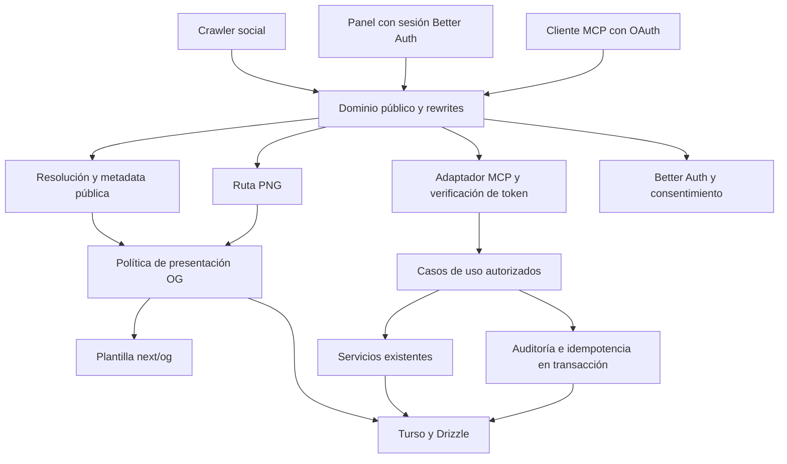

# Plan de implementación de imágenes OG y MCP autenticado para InsideLink

Fecha de revisión — 5 de noviembre de 2026.

Estado — En ejecución en `codex/inside-link-og-mcp`. Las puertas de validación requieren evidencia antes de avanzar.

Avance al 5 de noviembre de 2026:

- **P-01** verificada con SQLite en memoria: 78 pruebas, tipos y build en la línea base.
- **OG-01 a OG-04** implementadas en `62e428a`, con 79 pruebas en la suite. Quedan pendientes la revisión visual de fixtures en Linux y el smoke del dominio frontal de OG-05.
- **P-03** añade CI en `8643dd2`. Los controles de lint y formato cubren el código OG nuevo, su servicio HTML y la prueba de integración. La ejecución remota se comprobará cuando se publique la rama.
- **P-02** parcial. La petición al apex devuelve 308 hacia `www.cristianarando.dev` y el frontend añade barra final. El candidato es `https://www.cristianarando.dev/api/v1/mcp/`, pendiente de comprobar discovery y POST tras el proxy en un entorno de prueba. Los paquetes `@better-auth/mcp` y `@better-auth/cimd` 1.7.18 declaran Better Auth 1.7.18 como mínimo compatible. El SDK `@modelcontextprotocol/server` consultado publica 2.4.0. Falta validar este conjunto y las versiones reales de los clientes antes de habilitar OAuth MCP.

### Evidencia local de P-02

La prueba `tests/integration/mcp-oauth-probe.test.ts` usa Better Auth 1.7.18, MCP SDK 2.4.0 y SQLite en memoria. Descubre el recurso y el issuer, intercambia un código de un solo uso mediante PKCE S256 y ejecuta una herramienta de lectura con un token ligado al recurso. Rechaza peticiones anónimas y tokens inválidos. El perfil exige `MCP-Protocol-Version`, `Mcp-Method` y `Mcp-Name` para la llamada de herramienta, además de los metadatos de protocolo por petición.

La prueba usa el proveedor real de InsideLink con Drizzle/libSQL y la migración `0002_mcp_oauth.sql` sobre una base temporal. El cliente está registrado previamente y la sesión de prueba representa al propietario. Se verifican la redirección de invitados, el rechazo de otras cuentas, el consentimiento, la rotación de refresh tokens y la revocación explícita mediante `/oauth2/revoke`. Eliminar el registro de consentimiento por sí solo no invalida el refresh token.

El proveedor queda desactivado por defecto. Las ocho tablas se agregan a la base existente mediante `pnpm db:migrate`. Para probarlo en un entorno aislado, aplicar primero la migración y activar `MCP_ENABLED=true` con `BETTER_AUTH_URL` en el origen HTTPS de ese entorno. El portafolio necesita enrutar `/.well-known/oauth-protected-resource`, su variante `/.well-known/oauth-protected-resource/api/v1/mcp` y `/.well-known/oauth-authorization-server/api/auth` a InsideLink. Las rutas `/api/auth/*` siguen atendiendo los endpoints de Better Auth.

Quedan pendientes la ruta MCP con herramientas de InsideLink, la comprobación de concesiones activas en cada llamada, CIMD con clientes reales y las pruebas del login GitHub y discovery a través del proxy HTTPS.

## 1. Resultado esperado y decisiones principales

InsideLink debe producir automáticamente una tarjeta social por enlace y permitir que el propietario consulte y gestione enlaces desde clientes MCP autenticados. La implementación se divide en entregas pequeñas con contratos, pruebas y reversión independientes.

| Área         | Decisión propuesta                                                               | Razón                                                                                |
| ------------ | -------------------------------------------------------------------------------- | ------------------------------------------------------------------------------------ |
| Arquitectura | Ampliar el monolito modular Next.js existente                                    | Los servicios de enlaces, resolución y analítica ya encapsulan la lógica necesaria   |
| OG           | Render dinámico con `ImageResponse` de `next/og`, PNG 1200 × 630                 | Se integra con el runtime actual y evita portar toda la generación estática de Astro |
| Diseño OG    | Adaptar composición, tipografía y marca del portafolio                           | El contenido de la tarjeta debe representar al enlace o HUB                          |
| MCP          | Endpoint remoto Streamable HTTP en `/api/v1/mcp/`                                | Puede aprovechar el proxy actual de `/api/v1/*`                                      |
| Identidad    | Better Auth existente, GitHub como login y propietario único                     | Conserva la identidad y la restricción actuales                                      |
| OAuth MCP    | Paquetes oficiales compatibles de Better Auth, sujetos a una prueba inicial      | Implementar criptografía y flujos OAuth propios aumentaría el riesgo                 |
| Herramientas | Lectura primero, escrituras pequeñas en una segunda entrega                      | Permite validar autenticación y compatibilidad antes de modificar datos              |
| Persistencia | Turso/libSQL con Drizzle y migraciones aditivas                                  | Mantiene una única fuente de verdad                                                  |
| Modelos      | Sol medium por tarea delimitada, Astra high para revisión de decisiones críticas | El avance se acepta por evidencia de pruebas y revisión                              |

### Alcance de la primera versión

- Generación OG automática, imagen manual opcional, vista previa en administración y tratamiento explícito de enlaces protegidos.
- MCP para listar, consultar, comprobar slugs, consultar analítica agregada y obtener la URL OG.
- Segunda entrega de MCP para crear y editar enlaces, con control de concurrencia, idempotencia, auditoría y desactivación reversible.
- Conexión comprobada con los clientes y versiones recogidos en la matriz de compatibilidad.
- Borrado permanente, cambios de PIN, exportación masiva, consultas SQL arbitrarias, scraping de destinos y múltiples propietarios quedan como ampliaciones con diseño propio.

## 2. Base real inspeccionada

Repositorios de referencia en esta máquina:

- `C:/Users/crisa/Workspace/system-design/inside-link`, commit observado `3507699`.
- `C:/Users/crisa/Workspace/astro/my-portfolio`, corrección de formato subida previamente en `8c8e0e7`.

Las rutas siguientes son relativas al repositorio indicado. Antes de ejecutar, volver a comprobar HEAD y cambios locales. Los documentos históricos explican intención, mientras que el código y las pruebas determinan el comportamiento actual.

| Archivo o módulo                              | Hallazgo y uso en el plan                                                                                                       |
| --------------------------------------------- | ------------------------------------------------------------------------------------------------------------------------------- |
| `inside-link/AGENTS.md`                       | Exige consultar la documentación de la versión instalada en `node_modules/next/dist/docs/` antes de escribir código             |
| `inside-link/package.json` y lockfile         | Next 16.4.3, React 19.3.0, Drizzle, libSQL, Zod y Vitest. Better Auth instalado 1.7.13, aunque el rango declarado es `^1.2.0`   |
| `src/server/services/link.service.ts`         | Factoría inyectable `createLinkService(db)`, CRUD, validación del estado final, DTO y paginación por cursor reutilizables       |
| `src/server/services/resolution.service.ts`   | Decide redirección, PIN, expiración, HUB y respuesta a bots. El registro de clics también modifica `updatedAt`                  |
| `src/server/services/og-render.service.ts`    | Produce HTML OG y Twitter. Elige `ogImageUrl` o `/brand/og-default.png`. Todavía no genera PNG dinámicos                        |
| `src/app/(public)/[slug]/route.ts`            | Usa HTML manual para bots y HUB. Incorporar una convención de metadata de Next por sí sola no actualiza estas respuestas        |
| `src/server/auth/config.ts`                   | GitHub OAuth mediante Better Auth y bloqueo del propietario al crear cuentas                                                    |
| `src/server/auth/session.ts`                  | Guardas de sesión y bypass local de previsualización. MCP necesita una verificación de bearer token independiente de ese bypass |
| `src/server/db/schema.ts`                     | Enlaces globales para un propietario, sin `ownerId`, `version` ni tablas de auditoría MCP                                       |
| `src/lib/types/link-dto.ts`                   | `LinkDTO` administrativo incluye destinos. `PublicLinkDTO` limita información del directorio                                    |
| `src/lib/constants/reserved-slugs.ts`         | Reglas de colisión que deben revisarse junto al proxy                                                                           |
| `src/middleware.ts`                           | Contiene una réplica del contrato de rewrites y tratamiento del dominio técnico                                                 |
| `my-portfolio/vercel.json`                    | Proxy de `/api/v1/*`, `/api/auth/*`, administración y slugs. `trailingSlash` está activado                                      |
| `my-portfolio/src/utils/og-template.ts`       | SVG escapado, ajuste de textos y composición PNG con Sharp y assets locales                                                     |
| `my-portfolio/src/pages/og/[...route].png.ts` | Generación estática de tarjetas del portafolio durante build                                                                    |

### Diferencias que condicionan la implementación

1. El portafolio conoce sus páginas durante el build. InsideLink recibe cambios en base de datos después del despliegue. Las tarjetas deben actualizarse sin reconstruir el sitio.
2. `isPublic` regula la aparición en el directorio. Los slugs no listados siguen siendo accesibles por URL. Mantener esta semántica y añadir una política explícita para la información expuesta en previews.
3. El HTML de bots oculta la descripción de enlaces con PIN, pero todavía usa su título y puede seleccionar una imagen manual. La nueva política debe aplicarse de forma coherente al HTML y al PNG.
4. `updatedAt` cambia por visitas. No sirve como versión editorial ni como clave de la imagen.
5. El archivo `playwright.config.ts` es una configuración propia y las pruebas `tests/e2e/*.spec.ts` se ejecutan con Vitest contra handlers. Esto no acredita una prueba de navegador real.
6. InsideLink no declara un comando `lint` en el `package.json` inspeccionado. El portafolio sí lo exige en CI. La entrega debe incluir controles de formato reproducibles en el repositorio destino.

## 3. Arquitectura y límites de responsabilidad



Mantener funciones tipadas y factorías con dependencias explícitas. Los handlers traducen HTTP o MCP a casos de uso. La política de acceso recibe un principal autenticado. Los servicios conservan las invariantes del enlace. El renderer recibe datos de presentación ya autorizados. Evitar que una herramienta llame por HTTP a la API interna del mismo proceso.

Crear abstracciones cuando exista un límite real, como proveedor de autenticación, renderer o transacción. Reutilizar Zod y `createLinkService(db)`. No introducir un contenedor de inyección, un repositorio genérico o una reorganización completa de carpetas como requisito de estas funciones.

## 4. Imágenes OG

### 4.1 Motor y adaptación del diseño

Construir una plantilla JSX pura con `next/og`, ejecutada en Node. La documentación local de Next inspeccionada admite fuentes explícitas, flexbox y posicionamiento absoluto. Exige considerar el límite de bundle y el subconjunto de CSS compatible. Portar los elementos visuales necesarios como primitivas estáticas y probarlos en el renderer real.

Usar el portafolio como referencia de composición y marca. Adaptar sus márgenes, jerarquía tipográfica, bloque de autor y acentos discretos a título, descripción, categoría, slug y tipo de enlace. Evitar incorporar automáticamente su simulación orbital, rutas de assets o diccionarios de cinco idiomas a InsideLink.

Entregar una tarjeta base y una variante HUB. Mantener una única implementación con variantes de datos. La plantilla protegida será genérica. El idioma inicial seguirá el inglés de las previews actuales, con textos agrupados para una futura localización.

Fuentes locales versionadas con licencia compatible, cargadas como bytes y con cobertura de caracteres comprobada. Revisar títulos con español, acentos, emoji y CJK. Cuando un glifo no esté soportado, definir una sustitución estable. No depender de fuentes del sistema Windows. Si se requiere fidelidad SVG imposible con `ImageResponse`, registrar una decisión para Sharp, incluirlo como dependencia directa, runtime Node y fuentes reproducibles. Esta alternativa se decide en la prueba visual inicial.

### 4.2 Contratos y modelo

Añadir `ogMode` con valores `auto`, `custom`, `minimal` y default `auto`. Migrar filas con `ogImageUrl` no vacía a `custom`. Añadir `version` entero con default `1` para ediciones concurrentes, detallado en la sección MCP. Mantener `ogImageUrl` como URL de imagen personalizada.

Definir `OgPresentation` con campos explícitos para `kind`, `title`, `description`, `displaySlug`, `category`, `tags`, `imageAlt`, `locale` y `templateVersion`. El objeto no contiene PIN, destinos, URLs de botones HUB, cookies, estadísticas ni tokens.

`buildOgPresentation(link)` aplica la política de publicación. `resolveOgImage(presentation, link)` devuelve tipo de imagen, URL absoluta y metadata de dimensiones conocida. `renderOgImage(presentation)` produce el PNG. Ambos caminos, HTML y PNG, usan la misma política.

### 4.3 Política pública propuesta

| Estado                             | HTML y tarjeta accesibles sin login                                  | Caché inicial                                                |
| ---------------------------------- | -------------------------------------------------------------------- | ------------------------------------------------------------ |
| Activo, sin PIN, `auto`            | Título, descripción recortada, categoría y slug                      | Revalidación obligatoria                                     |
| Activo, sin PIN, `custom`          | Metadata permitida e imagen configurada                              | Revalidación de HTML, caché externa fuera de nuestro control |
| `minimal`                          | Marca y texto genérico                                               | Revalidación obligatoria                                     |
| Con PIN                            | Marca y aviso genérico de enlace protegido, prevalece sobre `custom` | `private, no-store`                                          |
| Inactivo, expirado o cuota agotada | Respuesta genérica, sin contenido anterior                           | `no-store`                                                   |
| ID inexistente                     | 404 genérico                                                         | `no-store`                                                   |

La interfaz debe explicar que `auto` publica título y descripción incluso cuando el enlace no aparece en el directorio. Para datos sensibles, seleccionar `minimal` o PIN. La política propuesta endurece la preview con PIN, que actualmente publica el título. Registrar este cambio de comportamiento en la entrega.

Las plataformas sociales pueden conservar previews descargadas. La aplicación puede impedir nuevas lecturas y revalidar su caché, pero no garantiza borrar copias ya almacenadas por terceros.

### 4.4 URL, revisión y caché

Ruta propuesta `GET /api/v1/og/[id]/[revision]/image.png`. Usar ID estable y verificar la fila actual en cada petición. El endpoint no acepta título, SVG, URL de destino, rutas de archivo ni contenido arbitrario por query string.

Calcular `revision` como SHA-256 truncado a 32 caracteres hexadecimales de una serialización determinista de `OgPresentation`, versión de plantilla y versión de fuentes. Es una clave de contenido, no una credencial. Los clics no alteran ese objeto. Las ediciones visuales sí alteran su hash.

Algoritmo de respuesta:

1. Validar ID y formato del hash antes de consultar la BD.
2. Leer el enlace y comprobar estado, PIN, expiración y cuota con el reloj del servidor. No invocar la ruta pública ni registrar una visita.
3. Construir la presentación autorizada y su revisión actual.
4. Ante revisión obsoleta, responder 404 con `no-store`. El HTML actualizado ya apunta a la nueva revisión.
5. Para filas normales, usar `Cache-Control: public, max-age=0, must-revalidate`, `ETag` derivado del contenido y desactivar caché compartida en Vercel/CDN inicialmente. Evaluar `If-None-Match` solo después de comprobar acceso y estado.
6. Para PIN, estados no disponibles y errores, usar `no-store`, sin 304 que pueda reutilizar contenido anterior.
7. Obtener o renderizar bytes con límites de CPU, tamaño y tiempo. Una caché LRU pequeña por instancia puede reducir render repetido, pero siempre después de verificar la fila y nunca como autoridad de acceso.

No devolver `immutable` para estas imágenes mutables y revocables. Una fase posterior puede incorporar almacenamiento de bytes por hash con verificación de permisos delante del almacenamiento. Habilitar caché CDN solo tras definir explícitamente la ventana de exposición aceptable y probar su invalidación.

### 4.5 Integración y seguridad

- Actualizar `og-render.service.ts` y las cabeceras HTML de HUB para usar la URL resuelta. Añadir `og:image:alt`, `twitter:image:alt` y dimensiones 1200 × 630 para las imágenes generadas. Las dimensiones de imágenes manuales se omiten si se desconocen.
- Comprobar la existencia real de la imagen fallback servida por el dominio público. Crear un fallback propio bajo `/api/v1/og/default/image.png` si la ruta `/brand/og-default.png` no tiene un asset válido en el proyecto que la sirve.
- En fallos de render, responder PNG genérico local, con `no-store` y registro de error sanitizado. Probar un fallo de carga de fuente y de lectura de BD por separado.
- Obtener el origen desde configuración validada. No construir URLs desde `Host` o `X-Forwarded-Host` sin una política de proxy confiable.
- No descargar la URL de destino ni la imagen personalizada para componer tarjetas. La imagen manual se referencia directamente y se valida como HTTPS en producción. Bloquear credenciales embebidas y esquemas no permitidos. Esto evita incorporar un fetcher con superficie SSRF.
- Escapar toda interpolación HTML. Revisar la serialización del script existente de redirección, porque `JSON.stringify` por sí solo no neutraliza `</script>` dentro de una URL. Añadir regresión con ese payload antes de integrar el nuevo HTML.
- Limitar título a 150 caracteres y descripción a 500 según el schema actual, más límites de líneas en la tarjeta. Mostrar como máximo tres tags. No reducir indefinidamente el tamaño de fuente para encajar texto.
- La vista previa administrativa de datos aún no guardados usa POST autenticado, cuerpo limitado y `no-store`. Evitar colocar descripciones privadas en URLs, logs o cachés públicas.

### 4.6 Experiencia administrativa

En `link-form-modal.tsx`, añadir selector Automática / Personalizada / Mínima y preview 1200 × 630 con proporción conservada. Mostrar la política de PIN y un texto claro sobre publicación de metadata. Reutilizar el guardado existente y validar `custom` con URL requerida. Un botón «Actualizar vista previa» basta para el primer alcance. Si se añade debounce, cancelar respuestas obsoletas y limitar peticiones. Dar acceso para copiar la URL de imagen una vez guardado el enlace.

## 5. MCP y autenticación

### 5.1 Perfil y compatibilidad de versiones

La especificación consultada resuelve `latest` a `2026-07-28`. Esta revisión usa un endpoint POST, elimina las sesiones de protocolo y el stream GET de revisiones anteriores. Adoptar un SDK oficial que implemente ese perfil y comprobar los clientes concretos. No mezclar ejemplos de SDK v1 y v2. [Transporte Streamable HTTP](https://modelcontextprotocol.io/specification/2026-07-28/basic/transports/streamable-http)

La documentación actual de Better Auth recomienda `@better-auth/mcp`, `@better-auth/cimd` y SDK TypeScript v2. El plugin MCP incorpora el proveedor OAuth y publica discovery. Requiere configurar firma JWT y prevenir la aceptación de JWT de sesión como access tokens. La versión instalada es 1.7.13 y la documentación consultada anuncia 1.7.18. Fijar un conjunto compatible tras revisar changelog, peer dependencies y migraciones. [MCP de Better Auth](https://better-auth.com/docs/plugins/mcp)

Puerta técnica obligatoria M-01:

- Registrar versiones exactas de Next, Better Auth, plugins, SDK, Zod y clientes.
- Crear un prototipo con una herramienta de lectura sin datos privados.
- Comprobar discovery, login, consentimiento, llamada y revocación desde cada cliente.
- Si un cliente exige una revisión anterior, documentar su versión y decidir un adaptador de compatibilidad soportado por el SDK o una versión mínima del cliente. Nunca degradar silenciosamente la autenticación.
- Resolver incompatibilidad de Zod en el borde MCP mediante schemas compatibles con el SDK o una actualización acotada y probada. La lógica de dominio sigue usando los validadores centrales.

### 5.2 Origen y rutas

Definir `PUBLIC_ORIGIN` a partir del dominio que realmente termina HTTPS en producción. El código y README mezclan apex y `www`, así que confirmar la redirección efectiva antes de fijar OAuth. La URL canónica elegida debe coincidir exactamente en endpoint, metadata, `resource`, audiencia y registro del cliente, incluida la barra final.

Primera opción `PUBLIC_ORIGIN + /api/v1/mcp/`, aprovechando la ruta existente. Probar POST por ambos proyectos Vercel, cabeceras de autorización y respuesta sin redirección. Si el `trailingSlash` del portafolio impide servir discovery o el transporte sin redirecciones, preferir un subdominio dedicado dirigido a InsideLink y registrar esa decisión antes de emitir tokens.

| Ruta                                                                 | Responsable                     | Requisito                                                                |
| -------------------------------------------------------------------- | ------------------------------- | ------------------------------------------------------------------------ |
| `/api/v1/mcp/`                                                       | InsideLink, proxy `/api/v1/*`   | POST autenticado, JSON-RPC y respuesta JSON para herramientas cortas     |
| `/api/auth/*`                                                        | Better Auth existente           | Login GitHub, OAuth, token, revocación y claves según versión del plugin |
| `/admin/integrations/consent`                                        | Nueva página InsideLink         | Consentimiento protegido por sesión real del propietario                 |
| `/admin/integrations`                                                | Nueva página InsideLink         | Clientes concedidos, scopes y revocación                                 |
| `/.well-known/oauth-protected-resource` y alias con ruta del recurso | Metadata generada por proveedor | GET público, valores canónicos consistentes                              |
| Discovery del authorization server en ubicación derivada del issuer  | Metadata generada por proveedor | Rewrites explícitos y sin captura por el slug handler                    |

Inventariar las URLs exactas que genera el plugin. Añadir al portafolio únicamente las reglas de discovery necesarias, incluyendo alias con base path. Actualizar `docs/portfolio-integration/vercel.rewrites.json`, pruebas de rewrites y `matchesPortfolioRewrite`. Reservar `mcp`, `oauth` y `consent` si se exponen como slugs raíz, verificando antes si ya existen. No sustituir el `/og/*` del portafolio por el generador de InsideLink.

### 5.3 Flujo OAuth

1. El cliente solicita el recurso MCP y recibe 401 con `WWW-Authenticate` y localización de metadata.
2. Descubre recurso, issuer, autorización y token endpoint.
3. Identifica su cliente mediante CIMD o registro previo. Habilitar DCR solamente si una compatibilidad comprobada lo requiere, con límites y política de clientes.
4. Inicia Authorization Code con PKCE S256 y el parámetro `resource` exacto.
5. Better Auth autentica al usuario con GitHub. Se verifica otra vez el propietario mediante cuenta GitHub vinculada y su ID inmutable.
6. El usuario consiente scopes concretos para ese cliente. La aprobación queda registrada.
7. El proveedor emite un access token limitado a InsideLink. El servidor valida cada petición y cada herramienta.
8. El panel permite revocar la concesión. La siguiente llamada debe fallar según el contrato de revocación definido abajo.

MCP define al servidor como recurso OAuth y exige metadata protegida y vinculación al recurso. La revisión consultada recomienda CIMD y conserva DCR como compatibilidad deprecada. [Autorización MCP](https://modelcontextprotocol.io/specification/2026-07-28/basic/authorization)

### 5.4 Principal y permisos

Crear `McpPrincipal` exclusivamente a partir de autenticación validada con `userId`, `clientId`, `grantId` y `scopes`. Resolver `grantId` desde el registro autorizado del proveedor si no forma parte de un claim confiable. Ninguno de esos valores llega como argumento controlado por el modelo.

Scopes propuestos:

| Scope            | Permisos                                                         |
| ---------------- | ---------------------------------------------------------------- |
| `links:read`     | Listar y consultar enlaces, comprobar slug y obtener metadata OG |
| `links:write`    | Crear o editar campos permitidos de enlaces                      |
| `analytics:read` | Consultar agregados de un enlace                                 |

El propietario se vuelve a verificar en cada acceso privilegiado, además de las restricciones de registro existentes. Un usuario de BD sin cuenta GitHub autorizada debe fallar. El bypass de desarrollo de `getAdminSession` no se usa para MCP ni para el consentimiento real. Las pruebas inyectan un verificador falso de forma explícita.

Validar firma, algoritmo permitido, issuer, audiencia, expiración, tipo de token, scopes, sujeto y concesión vigente. Rechazar ID tokens, JWT de sesión, tokens de GitHub y tokens dirigidos a otra API. La autenticación por cookie del panel no sustituye al bearer token MCP.

Propuesta operativa inicial: access tokens de 10 minutos, refresh tokens de hasta 30 días de inactividad, rotación y detección de reutilización soportadas por el proveedor. Fijar los valores en configuración y comprobarlos. Para revocación inmediata, consultar el estado persistente de concesión en cada petición, sin caché permisiva. Si el proveedor no permite esa garantía, añadir una tabla de revocación de concesiones con denegación por defecto y prueba de fallo. No prometer revocación inmediata solo por usar JWT.

El protocolo y el SDK gestionan parsing, negociación y lifecycle. El contexto de autorización debe ser por petición. Evitar variables globales que guarden el usuario actual. Responder 401 ante credenciales inválidas, 403 por permiso insuficiente y desafío de scope cuando corresponda.

### 5.5 Consentimiento y defensa frente a abuso

La pantalla muestra el cliente identificado, scopes solicitados y acciones permitidas. No autorizar automáticamente clientes nuevos ni añadir scopes al renovar tokens. Usar el flujo CSRF/state del proveedor, redirects exactos y códigos de un solo uso. Mantener separados los tokens GitHub internos y los tokens MCP.

Validar `Origin` cuando esté presente. Admitir clientes servidor sin esa cabecera tras autenticación. Configurar CORS con orígenes explícitos cuando se necesite, sin `*` con credenciales. Limitar cuerpos, conexiones, duración y frecuencia. Discovery permanece público, los datos administrativos requieren token.

CIMD puede implicar peticiones a URLs suministradas por clientes. Usar el fetcher seguro del proveedor y una política inicial de clientes permitidos. Bloquear destinos privados, loopback y metadatos cloud, controlar redirects, DNS, tamaño y timeout. Los callbacks loopback legítimos de clientes nativos se tratan con las reglas OAuth del proveedor, sin convertirlos en destinos de fetch permitidos.

Tratar títulos, descripciones y destinos devueltos por herramientas como datos no confiables. Una instrucción incrustada en un enlace no modifica scopes ni autoriza otra acción. Logs y auditoría excluyen bearer tokens, PIN, secretos y URLs completas con parámetros sensibles. [Seguridad MCP](https://modelcontextprotocol.io/docs/2026-07-28/tutorials/security/security_best_practices)

## 6. Contratos de herramientas

Usar herramientas específicas, schemas estrictos y respuestas acotadas. Los nombres siguientes son el contrato inicial propuesto. Declarar `inputSchema`, `outputSchema`, resultado estructurado y un resumen textual breve. Las anotaciones ayudan a los clientes, mientras que el servidor siempre impone permisos.

| Herramienta          | Entrada principal                                            | Salida                                           | Scope            | Anotaciones                       |
| -------------------- | ------------------------------------------------------------ | ------------------------------------------------ | ---------------- | --------------------------------- |
| `list_links`         | `cursor?`, `limit` 1–50, `q?`, categoría y estado existentes | Página de resúmenes, `nextCursor`, `hasNextPage` | `links:read`     | readOnly=true                     |
| `get_link`           | `id`                                                         | Detalle administrativo permitido y `version`     | `links:read`     | readOnly=true                     |
| `check_slug`         | `slug`, `excludeId?`                                         | Disponible, normalización y razón                | `links:read`     | readOnly=true                     |
| `get_link_analytics` | `id`, `period` 7d/30d/90d                                    | Agregados actuales                               | `analytics:read` | readOnly=true                     |
| `get_link_og`        | `id`                                                         | URL efectiva, modo, alt y tamaño conocido        | `links:read`     | readOnly=true                     |
| `create_link`        | `idempotencyKey`, campos de creación permitidos              | Enlace creado y `version`                        | `links:write`    | readOnly=false, destructive=false |
| `update_link`        | `id`, `expectedVersion`, `idempotencyKey`, `patch`           | Enlace actualizado y nueva versión               | `links:write`    | readOnly=false, destructive=true  |

Marcar `openWorldHint=false` para operaciones limitadas a la base de datos. Establecer `idempotentHint=true` en escrituras solo después de implementar la garantía real. No atribuir seguridad a las anotaciones ni a la confirmación de una interfaz concreta.

`list_links` devuelve ID, slug, título, tipo, categoría, estado, protección y versión, evitando destinos y descripciones extensas. `get_link` permite destinos al propietario con `links:read`, pero omite hashes y secretos. Esto debe explicarse en el consentimiento, ya que el cliente de IA recibirá esos datos. Analítica devuelve agregados sin eventos de visitantes.

Campos de escritura iniciales permitidos: slug, título, descripción, tipo, destino DIRECT, botones HUB, categoría, tags, icono validado, opciones de redirección existentes, visibilidad, activación, pinning, expiración, cuota y configuración OG. Excluir `pin`, `passwordHash`, contadores, timestamps, identidad y versión asignada por el cliente. Crear defaults seguros mediante el schema existente y un DTO MCP explícito. `update_link` admite `isActive=false` como desactivación reversible y exige revisión concurrente.

Usar las validaciones del servicio sobre estado final, incluidos cambios entre DIRECT y HUB. Limitar búsqueda a 200 caracteres, payload JSON MCP a 64 KiB y resultado a un presupuesto inicial de 32 KiB. Esos límites se ajustan con mediciones y se incluyen en pruebas.

Errores de dominio estables `VALIDATION_ERROR`, `NOT_FOUND`, `SLUG_ALREADY_EXISTS`, `SLUG_RESERVED`, `VERSION_CONFLICT`, `IDEMPOTENCY_CONFLICT` y `RATE_LIMITED`. Devolver errores de herramienta con `isError` según SDK, sin stack ni SQL. Reservar errores de protocolo para JSON-RPC inválido y métodos no admitidos. La respuesta puede incluir `requestId` y detalles de campos seguros.

## 7. Escrituras consistentes, auditoría e idempotencia

### 7.1 Concurrencia editorial

Añadir `links.version` con default 1. Incrementar atómicamente en toda edición administrativa o MCP, incluidas flags y PIN desde el panel. Los clics actualizan sus contadores sin modificar `version`. MCP siempre exige `expectedVersion` y ejecuta `UPDATE ... WHERE id = ? AND version = ?`. Cero filas afectadas significa conflicto o recurso inexistente, resuelto por consulta posterior.

Actualizar el panel y REST para transportar la versión. Durante transición, REST puede aceptar clientes antiguos sin versión únicamente si aplica una operación atómica segura que no sobrescribe un estado leído previamente. La opción preferida es desplegar cliente y API juntos, exigir versión en PATCH y actualizar sus tests. No dejar una ventana read-modify-write sin control bajo el pretexto de compatibilidad.

### 7.2 Transacción de mutación

Ampliar el servicio para aceptar una transacción compatible con Drizzle/libSQL y reutilizar la misma validación. Comprobar la API real del driver. No ejecutar una mutación con el singleton global desde dentro de una transacción diferente.

Tabla propuesta `operation_receipts` con ID, propietario, cliente, clave, nombre de herramienta, hash canónico de payload validado, resultado mínimo, fecha y expiración. Restricción UNIQUE sobre propietario + cliente + clave. Retención inicial 24 horas, declarada al cliente. Tabla `audit_events` con ID, actor, cliente, operación, linkId, campos modificados, versiones anterior/nueva, requestId y fecha. El historial de auditoría debe sobrevivir a la eliminación del enlace, con FK nullable o sin borrado en cascada.

Flujo obligatorio en una única transacción de escritura:

1. Buscar recibo existente. Si coincide payload y operación, devolver el mismo resultado. Si difiere, rechazar.
2. Reservar la clave con unicidad en BD.
3. Aplicar la mutación con validación y comparación de versión.
4. Persistir auditoría y resultado mínimo del recibo.
5. Confirmar y responder. Ante fallo, revertir todos los pasos.

Una carrera por la misma clave se resuelve releyendo el recibo confirmado después del conflicto o devolviendo un error reintentable acotado si la otra operación sigue activa. No usar un mapa en memoria. Inyectar fallos entre pasos y probar dos conexiones concurrentes. Si audit falla, la escritura MCP también falla.

No reutilizar el ID JSON-RPC como clave de idempotencia. Un timeout del cliente puede ocurrir después del commit, por lo que debe poder repetir la misma clave. La respuesta debe documentar la ventana de 24 horas. La clave repetida devuelve el resultado de la operación original aunque el enlace haya sido editado después.

Aplicar auditoría a ediciones del panel mediante el mismo punto de entrada cuando se introduzca este flujo, indicando origen `admin` o `mcp`. Conservar datos mínimos y purgar recibos expirados por tarea programada idempotente. Retención propuesta de auditoría 90 días, configurable.

## 8. Integración con clientes

### ChatGPT

Crear una conexión MCP personalizada con OAuth y endpoint HTTPS canónico. Capturar el redirect URI y los metadatos del cliente que muestre la configuración real. La documentación de OpenAI contempla CIMD, DCR o cliente previamente registrado y Authorization Code con PKCE. La disponibilidad de herramientas de escritura depende del producto, cuenta y políticas del workspace y se valida en la cuenta del propietario. [Autenticación OpenAI](https://developers.openai.com/plugins/build/auth) [Servidor MCP personalizado](https://developers.openai.com/api/docs/guides/custom-mcp-server)

La primera entrega no necesita una interfaz embebida del Apps SDK. Las herramientas y respuestas estructuradas cubren la gestión. Añadir componentes visuales sería una fase de producto posterior.

### Gemini CLI

Configuración orientativa que debe ajustarse al origen validado:

```json
{
  "mcpServers": {
    "inside-link": {
      "httpUrl": "https://DOMINIO_CANONICO/api/v1/mcp/"
    }
  }
}
```

Gemini CLI documenta transporte HTTP y OAuth remoto. Probar discovery, consentimiento y renovación en la versión instalada. La aplicación web Gemini, Gemini CLI y los agentes construidos con su API son superficies distintas. Este plan confirma la ruta documentada de CLI y deja la conexión de la aplicación web pendiente de soporte verificable. [MCP en Gemini CLI](https://geminicli.com/docs/tools/mcp-server/)

### Antigravity

```json
{
  "mcpServers": {
    "inside-link": {
      "serverUrl": "https://DOMINIO_CANONICO/api/v1/mcp/"
    }
  }
}
```

La documentación actual admite OAuth con PKCE y discovery CIMD/DCR. CIMD en Antigravity IDE requiere la versión mínima documentada, actualmente 2.6.0. Registrar la superficie usada, porque App, IDE y CLI pueden diferir. Obtener callbacks de documentación y configuración vigente. [MCP en Antigravity](https://antigravity.google/docs/mcp)

### Evidencia de compatibilidad requerida

Para cada cliente registrar versión/plan, revisión MCP negociada, mecanismo de registro, callback exacto, login, `tools/list`, lectura, escritura consentida cuando esté habilitada, refresh, revocación y error por scope insuficiente. Una celda sin ensayo queda `PENDIENTE`, nunca `COMPATIBLE` por inferencia.

## 9. Mapa de archivos propuesto

Crear solo los módulos que se necesiten en cada entrega. Los nombres pueden ajustarse para seguir convenciones locales manteniendo estas responsabilidades.

```text
src/server/og/presentation.ts                  política pública y revisión
src/server/og/card.tsx                         composición pura next/og
src/server/og/fonts.ts                         fuentes locales y carga acotada
src/server/services/og-render.service.ts       integrar metadata HTML existente
src/app/api/v1/og/[id]/[revision]/image.png/route.ts
src/app/api/v1/og/default/image.png/route.ts
src/app/api/v1/og/preview/route.ts              POST administrativo
src/server/auth/mcp-principal.ts               validación y propietario
src/server/auth/mcp-permissions.ts             scopes por operación
src/server/mcp/server.ts                       factoría del SDK
src/server/mcp/tools.ts                        registro y schemas de herramientas
src/server/mcp/results.ts                      DTO y traducción de errores
src/app/api/v1/mcp/route.ts                     adaptador HTTP
src/server/services/link-operations.service.ts mutaciones transaccionales
src/server/db/schema.ts                        ampliaciones aditivas
src/server/db/migrations/                      migraciones generadas y revisadas
src/app/(admin)/admin/integrations/page.tsx
src/app/(admin)/admin/integrations/consent/page.tsx
tests/unit/og-presentation.test.ts
tests/integration/og-images.test.ts
tests/integration/mcp-auth.test.ts
tests/integration/mcp-tools.test.ts
tests/integration/mcp-concurrency.test.ts
```

Las rutas well-known y tablas OAuth se generan o adaptan según el paquete elegido. No inventar schemas de tokens a partir de este árbol. Integrar las tablas adicionales en el `drizzleAdapter`, que actualmente enumera solo cuatro tablas de autenticación.

## 10. Plan ejecutable por entregas

Todas las tareas empiezan pendientes. Registrar por tarea archivos cambiados, comandos ejecutados, resultado y commit. Las estimaciones S/M/L expresan complejidad relativa.

| ID        | Dependencia | Trabajo concreto                                                                          | Criterio de aceptación                                                                        |
| --------- | ----------- | ----------------------------------------------------------------------------------------- | --------------------------------------------------------------------------------------------- |
| P-01 · S  | Ninguna     | Releer AGENTS, HEAD, docs de Next, lockfile, CI y estado local. Ejecutar baseline aislado | Fallos preexistentes separados de cambios nuevos, sin tocar producción                        |
| P-02 · M  | P-01        | Fijar origen, rutas y resolver prueba MCP/OAuth M-01                                      | Matriz de versiones y decisión de perfil documentadas, discovery y una lectura real funcionan |
| P-03 · S  | P-01        | Definir scripts de lint/formato y CI reproducible                                         | Instalación frozen-lockfile, formato, types y tests reproducibles en Linux                    |
| OG-01 · M | P-01        | Crear política `OgPresentation`, `ogMode` y migración                                     | Casos legacy, custom, PIN, minimal y no listado probados                                      |
| OG-02 · M | OG-01       | Plantilla, fuentes y fallback                                                             | PNG real 1200 × 630, revisión visual de fixtures y caracteres límite                          |
| OG-03 · M | OG-02       | Endpoint y revisión por contenido                                                         | Clics no cambian hash, revisión antigua falla, no hay tracking ni fuga con PIN                |
| OG-04 · M | OG-03       | HTML de bots/HUB y preview administrativa                                                 | URL absoluta válida, imagen accesible sin cookie, preview privada con sesión                  |
| OG-05 · S | OG-04, P-03 | Proxy, staging y captura desde crawler                                                    | Obtener HTML y PNG desde el dominio frontal, sin colisiones con OG de Astro                   |
| M-02 · L  | P-02        | Integrar proveedor OAuth, tablas, login y consentimiento                                  | Propietario único, refresh, revocación y rechazo de tokens incorrectos demostrados            |
| M-03 · M  | M-02        | MCP solo lectura con schemas y límites                                                    | Herramientas funcionan con SDK Inspector y scopes estrictos                                   |
| M-04 · L  | M-03        | Versión editorial, recibos y auditoría transaccional                                      | Pruebas concurrentes y fallos entre pasos, rollback completo                                  |
| M-05 · M  | M-04        | `create_link` y `update_link`, adaptar panel y REST                                       | Escrituras autorizadas, defaults e invariantes compartidas y conflictos visibles              |
| M-06 · M  | M-05, OG-05 | Clientes reales y pruebas del proxy OAuth                                                 | Matriz con evidencias y limitaciones registradas                                              |
| R-01 · M  | M-06, P-03  | Despliegue gradual, manual operativo y rollback                                           | Checks completos verdes, smoke remoto y revocación confirmados                                |

Entregas sugeridas como PRs separados: calidad/baseline, OG, OAuth+MCP lectura, escrituras consistentes y conexiones finales. La prueba OAuth inicial puede avanzar antes de la estética OG. Una falla de compatibilidad no obliga a bloquear la entrega OG.

## 11. Matriz de pruebas y calidad

### OG

- Título mínimo y de 150 caracteres, descripción larga, palabras sin espacios, acentos, emoji/CJK y caracteres HTML.
- DIRECT, HUB, imagen manual, fila legacy y datos parcialmente ausentes.
- PIN oculta datos en HTML y PNG, incluidas imágenes manuales y botones HUB.
- `isPublic=false` conserva su semántica y muestra advertencia de publicación en administración.
- GET y HEAD no aumentan `clicksCount` ni crean eventos. Bots y prefetch siguen las reglas actuales.
- Editar título cambia revisión. Clic y analítica no la cambian. Agregar PIN, expirar, desactivar, agotar cuota o eliminar impide reutilizar una tarjeta antigua mediante revalidación.
- `If-None-Match` no devuelve 304 si el estado ha cambiado. Diferenciar caché del navegador, CDN Vercel y caché propia.
- Fallback ante fuente/render/BD fallidos y presupuesto de tamaño comprobado.
- Capturas PNG reales desde Linux y revisión humana de overflow y jerarquía visual.

### Auth y MCP

- Sin token, expirado, firma errónea, issuer/aud incorrectos, ID token, JWT de sesión, token GitHub y usuario distinto del propietario.
- Scope insuficiente aunque se llame directamente a una herramienta oculta en `tools/list`.
- Consentimiento denegado, callback inválido, PKCE ausente/incorrecto, código reutilizado, refresh reutilizado y cliente revocado.
- Origin ajeno, headers de host manipulados, CIMD malicioso y recursos privados por redirección.
- JSON-RPC malformado, revisión no soportada, argumentos adicionales, cuerpos sobredimensionados y límites de salida.
- Mismo idempotencyKey y mismo payload, clave reutilizada con payload distinto, solicitudes simultáneas y timeout después del commit.
- Dos ediciones con la misma versión producen una sola escritura. Clic concurrente no invalida la versión editorial.
- Fallo de auditoría o recibo revierte la mutación. Reinicio de instancia conserva la idempotencia.
- Token válido antes de revocación falla después de revocación. Reinicio y rotación de claves preservan la política definida.
- Sesión local de preview no autoriza MCP. Usar identidad real en el smoke de staging.

### Comandos y aislamiento

Ejecutar comandos con variables ficticias y SQLite/libSQL de pruebas. `vitest.config.ts` carga `.env` si existe, por lo que verificar el destino antes de tests y migraciones. Nunca ejecutar `db:seed` contra datos reales como preparación de esta tarea.

```bash
pnpm install --frozen-lockfile
pnpm typecheck
pnpm test
pnpm build
```

Añadir scripts reproducibles `lint` y `format:check` en P-03, con configuración compatible con Next instalado y alcance sin churn global. Ejecutarlos antes del commit. Para pruebas reales de navegador, instalar y configurar el runner correspondiente y darle un script explícito. El actual archivo llamado `playwright.config.ts` no sustituye ese trabajo.

En `my-portfolio`, si se cambian rewrites, ejecutar las comprobaciones de su CI: `pnpm run lint`, `pnpm run check:i18n`, `pnpm run check`, `pnpm build`, `pnpm test`, `pnpm check:build` y revisión de dependencias aplicable. Verificar las ejecuciones remotas tras el push y registrar resultado real.

## 12. Operación, límites y despliegue

Variables nuevas propuestas `MCP_ENABLED`, `MCP_WRITES_ENABLED`, `MCP_RESOURCE_URL` y `OG_ENABLED`. Extender `src/lib/env.ts` con validación estricta y valores seguros. Los endpoints auth, scopes y duración de tokens deben derivarse de una configuración central. No exponer secretos con prefijo `NEXT_PUBLIC_`.

Límites iniciales propuestos, medibles y configurables: MCP 60 lecturas/minuto y 10 escrituras/minuto por concesión, payload 64 KiB, resultado 32 KiB. Implementar rate limiting persistente o de plataforma, con prueba entre instancias. No usar el mapa en memoria de una función serverless como protección global. Separar límites de login/token de límites de herramientas.

Medir duración p50/p95 de consulta, render y MCP, frecuencia de fallback, conflictos, 401/403/429 y fallos de refresh. Objetivos iniciales bajo carga de staging: lectura MCP p95 menor de 1 s y OG en caliente menor de 500 ms. Son presupuestos de diseño, pendientes de medición, no propiedades comprobadas del hosting.

Despliegue:

1. Crear rama y copia de seguridad de BD. Aplicar migraciones aditivas en una base aislada y probar una copia representativa sin secretos.
2. Desplegar InsideLink con flags desactivados. Verificar que los endpoints esperados existen y las rutas antiguas funcionan.
3. Desplegar reglas necesarias en el portafolio. Probar HTTP desde el dominio público con HEAD/GET de imágenes y POST de MCP, conservando Authorization y challenges.
4. Habilitar OG y comprobar vistas previas de enlaces reales de prueba.
5. Habilitar MCP lectura para el propietario y ensayar renovación/revocación con cada cliente.
6. Habilitar escrituras tras la matriz de concurrencia y una operación de prueba verificable.
7. Registrar los commits desplegados de ambos repositorios y revisar CI remoto.

Rollback: deshabilitar primero escrituras MCP, luego MCP completo si corresponde. Revocar concesiones afectadas. Para OG, volver al fallback mediante flag y desactivar rutas generadas cuando sea necesario. Mantener columnas aditivas para que el rollback de aplicación sea compatible, sin destruir tablas como mecanismo de reversión. Guardar las reglas anteriores del proxy y probar la restauración en staging.

La publicación desde modelos debe quedar acotada por scopes, confirmaciones que ofrezca cada host y controles del servidor. Para una futura herramienta de borrado permanente, diseñar una aprobación verificable adicional y política de recuperación antes de exponerla.

## 13. Cómo ejecutar este plan con otro modelo

La combinación propuesta por el propietario es razonable. Mi recomendación operativa es Sol medium para contratos, plantilla OG, handlers y pruebas por tarea. Usar Astra high para revisar OAuth, aislamiento de identidades, transacciones e idempotencia y para resolver fallos que contradigan el diseño. Es una recomendación de flujo de trabajo, no una garantía de calidad por modelo. Las fichas oficiales describen Astra para trabajo exigente y Sol 6.1 para código y trabajo complejo. Conservar el modelo Sol elegido por el usuario, sin cambiar silenciosamente de versión. [GPT-6 Astra](https://developers.openai.com/api/docs/models/gpt-6-astra) [GPT-6.1 Sol](https://developers.openai.com/api/docs/models/gpt-6.1-sol)

Prompt sugerido para una tarea:

```text
Implementa únicamente la tarea <ID> de docs/07-plan-og-y-mcp.md.
Lee AGENTS.md, el código actual y las dependencias de esa tarea.
Comprueba que los criterios de aceptación de las dependencias tienen evidencia.
Resume los contratos que vas a modificar y conserva las invariantes descritas.
Reutiliza los servicios existentes y la documentación de las versiones instaladas.
Implementa el cambio mínimo completo, incluyendo la migración y pruebas necesarias.
Ejecuta formato, lint, typecheck, pruebas relevantes y build según el alcance.
Entrega archivos cambiados, evidencia, decisiones pendientes y riesgos concretos.
Si una API del plan difiere de la versión real, documenta la diferencia y verifica
la alternativa oficial antes de continuar. No inventes compatibilidad ni resultados.
```

Antes de una nueva sesión, entregar este documento, el commit base y la evidencia de la tarea anterior. Evitar pedir toda la implementación en un único turno. Revisar cada entrega antes de seguir con cambios de seguridad o migraciones.

## 14. Criterio de finalización

- [ ] Enlace nuevo produce tarjeta automática sin rebuild.
- [ ] Imágenes manuales antiguas migradas y PIN/minimal aplicados coherentemente.
- [ ] Revisión de contenido independiente de clics y revocación de acceso en el servidor probadas.
- [ ] OAuth opera detrás del dominio público y restringe todas las herramientas al propietario y scopes concedidos.
- [ ] Clientes/versiones verificados en matriz, con Gemini web explícitamente pendiente si no hay soporte probado.
- [ ] Escrituras concurrentes y reintentadas mantienen enlace, auditoría y recibo consistentes.
- [ ] UI, REST y MCP comparten validaciones y versión editorial.
- [ ] Pruebas reales de proxy, PNG, OAuth y navegadores complementan los tests de handlers.
- [ ] Lint/formato, tipos, tests, build y CI remoto pasan.
- [ ] Migraciones, rotación, revocación y rollback documentados y ensayados.

Las decisiones iniciales pendientes de validación son el origen canónico exacto, el conjunto de versiones OAuth/MCP, la compatibilidad concreta de cada cliente y la disponibilidad de escritura en la cuenta de ChatGPT. El resto del plan define defaults implementables y criterios verificables para resolver esas puertas.
